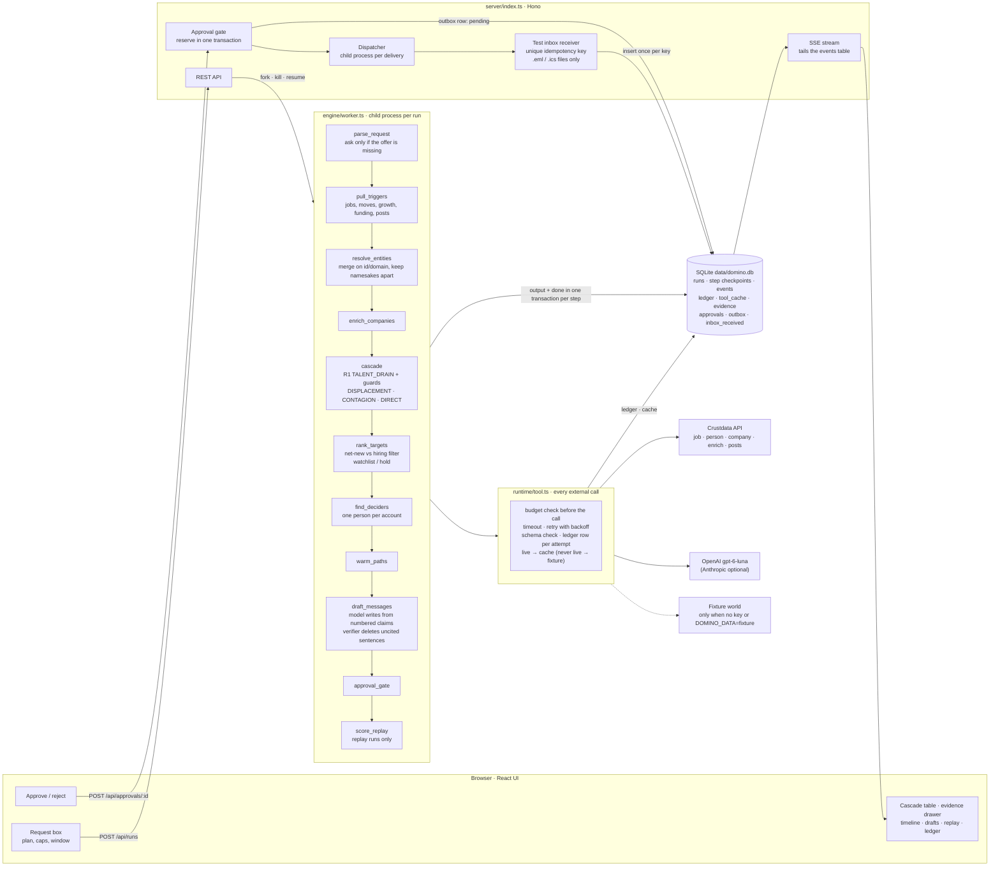

# DOMINO

**An Outbound Desk that finds the second domino.** You send a request, for example "We sell managed GPU inference.
Find AI companies whose changes in the last 30 days mean they'll need it, and book me meetings with the people who
decide". What comes back is finished work, held for approval: ranked accounts, the person who decides at each one, a
first message in which every claim cites a dated source, and a meeting hold. After a person approves, it is delivered
**once** to a test inbox.

ContextCon 05 (Crustdata x BITS Pilani), theme "Services, Replaced", problem **9.1 The Outbound Desk: meetings booked
on triggers from the last 30 days**. Team DOMINO. Built on 22 Nov 2026 between 10:15 and 18:00 IST; the commit history
starts at 12:16 IST.

- [The customer and the service](#the-customer-and-the-service)
- [Scope: now and later](#scope-now-and-later)
- [Run it from a fresh clone](#run-it-from-a-fresh-clone)
- [Stack](#stack)
- [Architecture, data, state and hosting](#architecture-data-state-and-hosting)
- [How it decides](#how-it-decides)
- [What's live vs cached](#whats-live-vs-cached)
- [Sources, approvals and send-once](#sources-approvals-and-send-once)
- [Budgets and the cost ledger](#budgets-and-the-cost-ledger)
- [Experiments](#experiments)
- [Robustness cases](#robustness-cases)
- [Limitations and who it could get wrong](#limitations-and-who-it-could-get-wrong)
- [Approaches considered](#approaches-considered)
- [Models and tools](#models-and-tools)
- [Next steps](#next-steps)
- [Team and declaration](#team-and-declaration)

## The customer and the service

**Customer:** a vendor of AI infrastructure (managed inference, GPU capacity, ML platform tooling) that pays a sales
development agency or a lead-qualification firm per meeting booked with the right buyer.

**The service DOMINO replaces** is the research half of that agency: watch for triggers, work out who now has the
problem, find the person who owns it, and write a first message that shows the homework. Most agencies and signal tools
watch one trigger, a company's own hiring: "X posts an inference role, so X needs inference." That signal is first
order, and every competitor sees it on the same day.

DOMINO looks for needs that **another company's move created**. If B hires three of A's serving engineers, A is the
account to call: it has just lost the people who run its inference and hasn't posted a role yet. A hiring filter can't
see that, because A is losing people rather than hiring them.

## Scope: now and later

**Now (built today and working end to end):**

- A free-text request goes in and a finished, approval-gated result comes out, with no one stepping in. DOMINO asks one
  question only when the request doesn't say what you sell, because every rule depends on it.
- It reads live Crustdata data: job posts, people's moves with their previous employer, company growth and funding,
  company enrichment, company posts, and decision-makers.
- It applies three cross-company rules (talent drain, displacement, contagion) next to a first-order hiring baseline,
  and marks which accounts the baseline would have missed.
- Every claim carries a dated source. A verifier deletes any sentence whose numbers, dates or names aren't in the cited
  evidence. Anything undated is listed under "I can't verify" and left out of the message.
- A person approves each send and meeting hold, and each is delivered once to a local test inbox (`.eml` / `.ics`).
  That holds through retries, double clicks and crashes.
- Every run has credit, model-spend and time caps that can be lowered mid-run, and a ledger row for every call attempt.
- The engine can be killed mid-run and resumed from the last checkpoint without repeating calls.
- A replay mode freezes the world at 1 Sep 2026 and scores DOMINO's picks against two baselines on what happened next.

**Later:**

- Crustdata watchers instead of polling, so a rule fires on the day of the third departure.
- More cross-company rules (vendor churn, customer concentration, a key customer's funding).
- Rule confidence learned from replayed outcomes instead of hand-set bases.
- Real delivery (an email provider and a calendar) behind the same approval gate and idempotency key, plus tracking
  which meetings were booked and which accounts bought.

## Run it from a fresh clone

Requirements: [Bun](https://bun.sh) 1.2 or newer (`curl -fsSL https://bun.sh/install | bash`, or
`brew install oven-sh/bun/bun`). Nothing else is needed: SQLite is built into Bun.

```bash
git clone https://github.com/Begarudev/domino && cd domino
bun install
bun start            # builds the UI on first run, then serves http://localhost:4321
```

Open <http://localhost:4321>, type a request (or keep the example) and press Run. If port 4321 is taken ("DOMINO could
not bind the server port"), pick another: `DOMINO_PORT=4399 bun start`.

**Without API keys**, DOMINO runs on a labelled synthetic fixture world (the data badge reads "Fixture") and writes
drafts from an evidence template. Every feature works this way, including approvals, crash and resume, the ledger and
replay. **For live data**, create `.env` in the repo root. It is gitignored and never committed:

```
CRUSTDATA_API_KEY=...      # live Crustdata reads; with a key the default data mode is live
OPENAI_API_KEY=...         # model-written request parsing and drafts (OPENAI_MODEL, default gpt-6-luna)
ANTHROPIC_API_KEY=...      # optional alternative provider (ANTHROPIC_MODEL, default claude-opus-5-5); used only without an OpenAI key
DOMINO_DATA=live           # optional: live | cache | fixture
DOMINO_PORT=4321           # optional
```

Tests:

```bash
bun run test         # unit, domain and engine tests (bun test server); 7 live-adapter checks skip without a Crustdata key
bun run test:e2e     # end to end over HTTP: messy input, timeouts, kill/resume, double approve, budgets, replay
bun run smoke        # one scripted run: approve twice, kill the engine and resume
bun run typecheck
```

Other scripts: `bun run dev` (hot-reload UI and server), `bun run probe` (checks the live adapters against Crustdata),
`bun run snapshot` (exports cached live responses for an offline demo).

## Stack

| Layer | Choice |
|---|---|
| Runtime, package manager, tests | Bun (TypeScript runs natively; `bun test`) |
| Server | Hono on Bun: REST plus Server-Sent Events. The engine runs as a separate child process per run |
| Frontend | React 19 + Vite, built to static files that the server serves |
| State | SQLite in WAL mode (`data/domino.db`): runs, step checkpoints, append-only events, ledger, tool cache, evidence, approvals, outbox, inbox, asks |
| Data | Crustdata REST API, `x-api-version: 2025-11-01`: `/job/search`, `/person/search`, `/company/search`, `/company/enrich`, `/social_post/search` |
| Models | OpenAI `gpt-6-luna` (reasoning effort none; $0.10 / $0.50 per million tokens) for request parsing and the claim-backed middle of each draft; deterministic template fallback; Anthropic `claude-opus-5-5` supported but unused today |
| Validation | zod schemas on every provider response (a nonsense response is rejected and retried) |

## Architecture, data, state and hosting

Rendered by GitHub from [`docs/architecture.mmd`](docs/architecture.mmd):



- **Server** (`server/index.ts`): REST, the SSE stream and the built UI. It never runs pipeline steps itself.
- **Engine** (`server/engine/worker.ts`, `steps.ts`): one child process per run, eleven steps in a fixed order. Each
  step writes its output and its `done` flag in one SQLite transaction, so a killed engine resumes at the next step and
  reuses everything before it.
- **Tool wrapper** (`server/runtime/tool.ts`): the only way out of the process. It checks the budget before each call,
  then applies a timeout, retries with backoff and validates the response schema, and writes a ledger row per attempt.
- **Domain** (`server/domain/`): entity resolution, the cascade rules, ranking, deciders, drafts and the verifier, and
  replay scoring. Pure functions, unit-tested.
- **Data adapters** (`server/crustdata/`): one spec per endpoint (request builder, parser to dated evidence rows, credit
  estimate). Notes on what we learned about the API are in [`server/crustdata/NOTES.md`](server/crustdata/NOTES.md).
- **State**: everything lives in SQLite at `data/domino.db`. The UI is rebuilt from the append-only events table, so a
  browser refresh or a server restart loses nothing.
- **Hosting**: runs locally on the demo laptop (`bun start`). Nothing leaves the machine except Crustdata and model
  API calls. Deliveries go to files under `data/outbox/`.

Build contract and event types: [`docs/CONTRACT.md`](docs/CONTRACT.md).

## How it decides

Each rule produces an **edge** from the company whose move caused the need to the company that now has it. An edge
carries its dated evidence rows, a confidence, a one-line rationale, and the competing explanation it couldn't rule
out. Every rule needs **at least two dated, verifiable evidence rows**. Facts without dates never count.

**R1 TALENT_DRAIN.** B hired **3 or more** of A's inference, serving or ML-platform engineers within 90 days, with the
3rd inside the last 30 days. A has to buy capacity or help instead of rebuilding in-house. Guards (any one of them
moves the account to *Hold* and keeps it from being drafted):

- A move counts only if it is *conclusive*: both old and new titles are recognised serving titles (hardware design and
  non-engineering titles are excluded outright), the previous role ended at most 60 days before the new one started,
  and the dates settle the window.
- Crustdata role dates are month-precision. A month that straddles the 30- or 90-day boundary can't settle the window,
  so it is held with "month-only dates cannot settle the 30-day window".
- A shared parent, related domains or a configured company family means an internal transfer, so the account is held.
- An acquisition or acqui-hire between the two companies is held.
- More than 40% of A's headcount moving at once looks like a team lift or a data error, so it is held.
- An ambiguous company identity (several candidate records) is held.
- Giants (over 5,000 staff) are excluded as losers.
- **Watchlist:** an account at 2 of 3 is shown with its dated evidence and is never drafted. The card fires on the 3rd.

**DISPLACEMENT.** An inference provider was acquired, shut down or repriced (a dated source), and B's dated job posts
name that provider's product. B needs a contingency plan for the integration. Displacement events are configured per
seller in `config/seller.json` with their source URL and date, and must match the post's product field exactly.

**CONTAGION.** A peer of B (same industry and size band within 3x, or a listed competitor) made dated technical moves
(at least two infra job posts or relevant hires), and B has posted no matching roles. B is likely to face the same
scaling problem next. Held accounts, related domains and companies already hiring are excluded. The peer reason is
shown on the edge ("same segment, 50–75 staff").

**DIRECT (the baseline).** B posts infra roles itself. This *is* the first-order hiring filter, kept to compare
against. Every target shows whether the hiring filter would have found it (`netNew`).

**Confidence**, written out on every edge:
`base × (1 − 0.5^n) × 2^(−age/30)`, clamped to 0.05–0.95. Here *n* counts the distinct dated rows and *age* is the
number of days since the newest row. The bases are 0.98 for talent drain, 0.95 for displacement, 0.86 for contagion
and 0.74 for direct, plus 0.05 when there is dated funding.
**Ranking** multiplies confidence by industry fit and size fit (20–2,000 staff) and by a 45-day recency decay.
Actionable accounts come first. Held and watchlist accounts are listed after them and never get a draft.

**Entity resolution:** one company under two names stays one record (same Crustdata id or domain). Two companies that
share a name stay apart (different domains). Every merge and every split is shown with its matching key.

## What's live vs cached

The data badge in the header always says which world a run is in, and every evidence row records its own mode.

| Mode | When | What happens |
|---|---|---|
| **live** | `CRUSTDATA_API_KEY` set (default) | Every read goes to Crustdata. The raw response is cached in `tool_cache` keyed by endpoint and request |
| **cache** (fallback) | a live call times out, errors or returns nonsense after its retries | the same request is answered from the cached live response; the timeline shows a `tool.fallback` line and the evidence row says *cached*, with its retrieval time |
| **unavailable** | no cached response either | the source is skipped with a warning; the run continues without it and never invents data |
| **fixture** | no key, or `DOMINO_DATA=fixture` | a labelled synthetic world (`server/crustdata/fixtures/`), used for tests and keyless clones. A live run **never** falls back to fixtures |

In live mode a request already in the cache is answered from it (a ledger row with status `cache_hit` and 0 credits).
"Re-check" on an evidence row forces a fresh live read. Cached live responses stay on the machine and aren't committed.

## Sources, approvals and send-once

**Sources.** Every evidence row records the endpoint, the record id, the JSON field, the public URL when there is one,
the date the fact happened, when DOMINO retrieved it, and whether it came from live, cache or fixture. A draft cites
rows as `[n]`. Hovering a citation lights up its row in the evidence drawer.

**Drafts.** The model never sees raw data. It gets numbered claims built from dated rows and writes only the middle of
the message, citing `[n]`. The greeting, meeting ask and sign-off are fixed seller copy. The verifier then deletes any
sentence with a number, date or name that isn't in the evidence it cites, and lists what it removed. Claims without a
date or source go into an "I can't verify" list and never reach the message. With no model key, drafts come from a
deterministic evidence template that goes through the same verifier.

**Approvals.** Nothing irreversible happens without a person. Each verified draft creates two pending approvals, a
`send_message` and a `meeting_hold`. Held or watchlist accounts get none. DOMINO has no code path that sends real
email or calendar invites: delivery writes `data/outbox/<key>.eml` and `.ics` files addressed to
`test-inbox+<key>@domino.invalid`.

**Send-once, end to end:**

1. The idempotency key is a hash of (run, company, person, message body, kind), fixed when the approval is created.
2. Approving *reserves* the delivery in one SQLite transaction. If the approval was already decided, or an outbox row
   for the key exists, it doesn't reserve again.
3. A separate dispatcher process delivers to the receiver. The receiver inserts into `inbox_received` with the key as
   primary key (`ON CONFLICT DO NOTHING`), so a second delivery of the same key returns `already_delivered`. A
   different message under the same key is refused.
4. If the dispatcher dies between the inbox accepting the message and the outbox being marked delivered, the outbox
   row stays `pending` and the timeline says so. Retrying the approval or resuming the run dispatches it again, the
   receiver answers `already_delivered` for that key, and the outbox row is completed from the original receipt. A
   retry can't produce a second message. (`?chaos` can inject exactly this crash.)
5. Approving again shows "already sent, not sent again" (an `action.duplicate_blocked` event).

**Personal data.** DOMINO keeps one decision-maker per account (name, title, employer, role dates, public profile URL).
It never requests emails or phone numbers. People who moved appear only as counts and dated rows inside the evidence
drawer. The sample event stream in `docs/` has names and profile URLs redacted.

## Budgets and the cost ledger

Every run has three ceilings: Crustdata credits, model spend in USD, and wall-clock seconds. The API defaults are 100
credits, $0.50 and 300 s; the UI request box uses 600 credits. You can lower any ceiling mid-run
(`POST /api/runs/:id/limits` or the meters in the UI). The tool wrapper checks the *estimated* cost of each call
**before** making it, and stops with a partial result and status `budget_exhausted` when the next call would cross a
ceiling.

The ledger has one row per **attempt** of every external call, including retries, timeouts, cache hits, fixture reads
and injected failures. Credits come from Crustdata's `X-Credits-Used` header (or the endpoint's rate card when the
header is missing); model rows record input/output tokens and USD at the cached rate card.

Example: live run `run_1b4fda05` (22 Nov, 13:32 IST), from the request in the opening paragraph. Excerpt:

| time (UTC) | step | provider | endpoint | mode | status | attempt | credits | tokens in/out | USD | ms |
|---|---|---|---|---|---|---|---|---|---|---|
| 08:02:26 | parse_request | openai | gpt-5-mini | model | ok | 1 | 0 | 257 / 268 | 0.00060 | 3,781 |
| 08:02:30 | pull_triggers | crustdata | job_search | live | ok | 1 | 2.4 | | | 2,988 |
| 08:02:33 | pull_triggers | crustdata | person_recent_moves | live | ok | 1 | 11.5 | | | 923 |
| 08:02:34 | pull_triggers | crustdata | company_growth | live | ok | 1 | 41.0 | | | 2,223 |
| 08:02:36 | enrich_companies | crustdata | company_enrich | live | ok | 1 | 30.0 | | | 8,243 |
| 08:02:49 | find_deciders | crustdata | person_deciders | live | ok | 1 | 0.23 | | | 408 |
| 08:02:51 | draft_messages | openai | gpt-5-mini | model | timeout | 1 | 0 | | 0 | 12,001 |
| 08:03:04 | draft_messages | openai | gpt-5-mini | model | timeout | 2 | 0 | | 0 | 12,001 |
| 08:05:50 | draft_messages | openai | gpt-5-mini | model | ok | 1 | 0 | 295 / 154 | 0.00038 | 2,813 |

Run totals: **86.3 Crustdata credits, $0.0073 of model spend, 30 ledger rows, 216 s of wall time** (including a
deliberate kill and resume). The run also hit 14 model timeouts before we fixed the OpenAI adapter; each one is on the
ledger and was retried. Total Crustdata spend for the whole build day was about 960 credits.

## Experiments

All thresholds and the replay protocol were **written down before any outcome was counted**, and none changed after.

### 1. Live yield of the talent-drain rule (13:43 IST)

The question: on live data, how many accounts does R1 at threshold 3 produce this quarter? Full method in
[`docs/YIELD.md`](docs/YIELD.md).

| Funnel step (live Crustdata, 24 Aug – 22 Nov 2026) | Count |
|---|---|
| People with an infra/serving past title and a new role since 24 Aug | 1,410 (1,200 fetched) |
| Direct moves (previous role ended ≤ 60 days before the new one) | 649 |
| ...whose previous role was itself infra/serving | 233 |
| ...from a company with ≤ 5,000 staff | 120 |
| Distinct companies that lost someone | 118 |
| Companies with 2 such departures (watchlist) | **2** |
| Companies with ≥ 3 (R1 fires) | **0** |

**The honest zero.** R1 fires on **0** accounts today. We kept the threshold at 3 rather than lowering it after seeing
the count, because a rule tuned to the data it is scored on proves nothing. Two accounts sit on the **watchlist** at
2 of 3, with their dated evidence:

- **Poolside**: 2 inference engineers left, both for NVIDIA, Sep 2026.
- **Abacus.AI**: 2 ML-platform engineers left, Oct and Nov 2026.

Neither is drafted; the card fires on the third departure. Live drafts today come from CONTAGION and the DIRECT
baseline.

What we learned: Crustdata role dates are month-precision, so a 30-day window can only be settled when the whole month
is inside it. Drains of three or more serving engineers from one company in a quarter are rare in public data. And the
first query returned zero because it combined filters that matched nothing; counting the funnel step by step found it.

### 2. Latest live forward run

`run_1b4fda05` (13:32 IST): 214 triggers from 363 dated evidence rows, 125 canonical companies after 22 merges,
20 cascade edges (all CONTAGION), **5 ranked accounts**:

| Account | Rule | Hiring filter would find it? |
|---|---|---|
| Arrive AI | CONTAGION (+ dated funding) | no |
| ChronoScale | CONTAGION (+ dated funding) | no |
| Linq | CONTAGION (+ dated funding) | no |
| PaleBlueDot AI | CONTAGION | no |
| Bright Vision Technologies | DIRECT (baseline) | yes |

The run found 3 decision-makers, wrote 5 verified drafts and queued 10 approvals (a message and a hold for each). It
cost 86.3 credits and $0.0073 in 216 s.

### 3. Replay from 1 September

**Protocol (frozen 22 Nov 2026, 13:40 IST, before any replay outcome was looked at):**

- **Question:** do accounts flagged by the cross-company rules show the predicted need later, more often than accounts
  a plain filter would pick?
- **As-of date:** 1 Sep 2026. Predictions use only facts dated on or before it. Profile-based moves count only once
  30 days old (people update profiles late), so a move is usable at 1 Sep only if it started by 2 Aug. Month-precision
  dates count only when the whole month is inside the window.
- **Cohort:** AI/ML companies with 20–5,000 staff returned by Crustdata company search for the request, plus the
  companies their departing infra/serving engineers came from. Giants and staffing firms are excluded. The request
  fixes the cohort; outcomes don't.
- **Outcome:** within 60 days of the as-of date, a dated serving, infra or ML-platform job post or hire at the account.
  Outcomes say the company *showed* the need, never that it bought anything.
- **Baselines:** (1) the first-order hiring filter (companies that posted infra roles before the as-of date);
  (2) companies whose headcount grew 30% or more.
- **Reported:** raw counts per arm (predicted, showed the need, did not). We compute no lift statistics, and small
  numbers stay small, including when DOMINO loses.
- **Caveat (also on screen):** this isn't a point-in-time snapshot. It is today's Crustdata index filtered by fact
  dates, so records that changed or disappeared since 1 Sep can't be seen.

**Result** (live replay `run_396d5e95`, 1 Sep → 22 Nov, 0 facts after 1 Sep used, 54.4 credits):

| Arm | Predicted | Showed the need | Did not |
|---|---|---|---|
| DOMINO | 5 | 2 | 3 |
| First-order hiring filter | 34 | 13 | 21 |
| Headcount +30% | 0 | 0 | 0 |

What this does and doesn't show: no cross-company edge survived the 1 Sep as-of filter, so all 5 DOMINO picks came
from the DIRECT rule. The replay tests the harness, the time guards and the baseline. It isn't yet evidence that the
cascade rules beat hiring. We report it anyway.

## Robustness cases

| Case | What happens |
|---|---|
| Messy request ("pls find ai cos needing gpu infra, india") | parsed into an intent; every default shown as an assumption |
| Request missing what you sell | one question, with a default; the run waits in `awaiting_input` |
| Tool timeout | retried with backoff, shown in the timeline (injected faults only with `?chaos` and labelled as injected) |
| Tool returns nonsense | the schema check rejects it; retried and logged |
| Live call keeps failing | answered from the cached live response with a visible fallback line; never from fixtures |
| Same company, two names | merged, with the matching key shown |
| Same name, different companies | kept apart, with the reason |
| Parent/subsidiary transfer, acqui-hire | not counted as a talent drain; held with the reason |
| Undated claim | "I can't verify", kept out of the message |
| Engine killed mid-run | resumes from the last checkpoint; no repeated calls or sends |
| Approve twice, or approve across a server restart | "already sent, not sent again" |
| Budget lowered mid-run | stops before the next paid call with a partial result |

These cases are covered by `bun run test` (71 tests in 12 files; 64 run without keys and the 7 live-adapter checks
need a Crustdata key), `bun run test:e2e` (8 HTTP scenarios) and `bun run smoke`.

**Fresh-clone check (22 Nov, 13:55 IST):** on a clean HTTPS clone with no `.env`, `bun install` (83 packages, 0.1 s),
`bun run test` (64 pass, 7 skip, 0 fail), `bun run smoke` (pass), `bun run test:e2e` (8 pass) and `bun run typecheck`
(clean) all succeeded first time. `bun start` built the UI and served it, and the example request reached the approval
queue in 4 s on the fixture world, with 7 accounts, 5 drafts, 10 approvals, 0 credits and the "Fixture" badge.

## Limitations and who it could get wrong

- **A drain that isn't one.** Engineers can leave because of a re-org, a deliberately smaller team, or a sabbatical.
  Every edge shows that competing explanation, rules need two or more dated rows, and a person approves every message.
- **Late profile updates.** People change their profiles weeks after they move, so a live 30-day window misses some
  moves and replay adds a 30-day lag. Month-precision dates near a boundary are held rather than guessed.
- **Thin yield.** At threshold 3, R1 is rare in public data (0 accounts today). Most live drafts come from CONTAGION,
  which is the weakest mechanism (base 0.86) and the most likely to be wrong about a specific company's roadmap.
- **Replay isn't point-in-time** (see the caveat above), and the first replay shows no cross-company edges at 1 Sep.
- **Displacement depends on configured events.** It only fires for provider changes listed with a dated source in
  `config/seller.json`; the shipped config holds fixture examples.
- **Coverage bias.** Companies and people that Crustdata indexes thinly (small Indian startups with sparse profiles)
  produce fewer dated rows, so DOMINO stays quiet about them instead of guessing.
- **No real delivery.** By design, everything goes to a local test inbox.

## Approaches considered

| Approach | Why not, or why |
|---|---|
| A first-order hiring filter ("X posts an inference role") | Every signal tool already does this, so the meeting goes to whoever emails first. We kept it as the baseline to beat |
| A chat agent that browses and writes messages | Can't prove where each fact came from or that a message was sent once; facts drift with the model's memory |
| An LLM deciding which accounts matter | Not reproducible and can't be replayed honestly; we use explicit rules with written guards and let the model write only from numbered claims |
| **Explicit cross-company rules over dated evidence, a verifier, an approval gate and a replay (chosen)** | Every decision is explainable and replayable from a past date, and the cost of each call is visible |
| Lowering R1 to 2 departures after seeing 0 | Rejected: thresholds were fixed before counting. 2-of-3 accounts go on a watchlist instead |

## Models and tools

- **OpenAI `gpt-6-luna`** (reasoning effort none): request parsing to a structured intent, and the cited middle of
  each draft. Timeouts of 20 s (parse) and 30 s (draft), 2 attempts, every call on the ledger.
- **Deterministic template**: drafts when no model key is set or the model keeps failing; it goes through the same
  verifier.
- **Anthropic `claude-opus-5-5`**: supported provider, used only when it is the only key set (not used in today's runs).
- **Crustdata REST API**: all live data (see [Stack](#stack)).
- **Built with** Bun, Hono, React, Vite, SQLite and zod, using AI coding tools (Claude Code and OpenAI Codex) under the
  team's direction.

## Next steps

1. Crustdata watchers on the watchlist accounts (Poolside, Abacus.AI), so R1 fires on the day of the third departure.
2. Live DISPLACEMENT events from dated news and posts instead of a configured list.
3. A replay over several as-of dates, enough to compare the cascade rules with the baseline on more than a handful of
   accounts, and confidence bases learned from it.
4. Real delivery behind the same gate and key, plus outcome tracking (meeting held, opportunity opened).

## Team and declaration

Team **DOMINO**, ContextCon 05, BITS Pilani, 22 Nov 2026.

**Prepared before 10:15 IST:** the DOMINO idea document (text only). No code, prompts or designs were prepared
beforehand. All code, prompts and designs in this repository were written on 22 Nov 2026 after 10:15 IST, with AI
coding tools; the commit history starts at 12:16 IST.
