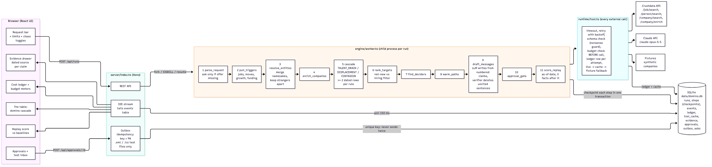

# DOMINO

**An Outbound Desk agent that finds the second domino.** A request goes in ("We sell managed GPU inference. Find AI
companies whose changes in the last 30 days mean they'll need it, and book me meetings with the people who decide").
A finished, approval-gated result comes out: ranked accounts, the person who decides at each, a first message where
every claim links to a dated source, and a meeting hold, sent **once** to a test inbox after a human approves.

ContextCon 05, theme "Services, Replaced", track 9.1 *The Outbound Desk: meetings booked on triggers from the last 30 days*.

> Work in progress: built on 22 Nov 2026 between 10:15 and 18:00 IST (see the commit history).

## The job it replaces

Sales development agencies and lead-qualification firms are paid per meeting booked with the right buyer. Their
research half is: watch for triggers, work out who now has the problem, find who owns it, write a message that proves
the homework. Most of them (and most signal tools) watch one trigger, **hiring**: "Company X posts an inference role,
so X needs inference." That is first-order, and everyone sees it at the same moment.

DOMINO looks for needs that **another company's move created**:

| Rule | Dated change at company A | Predicted need at company B | Why a hiring filter misses it |
|---|---|---|---|
| TALENT_DRAIN | A hired >= 2 of B's inference/serving engineers in the window | B must now buy managed inference instead of rebuilding in-house | B is losing people, not posting roles yet |
| DISPLACEMENT | Inference provider A was acquired / shut down / repriced (dated source) | B, whose dated job posts name A's product, must migrate | B's posts are about using A, not buying |
| CONTAGION | A (B's peer) made a dated infra move | B has the same profile and no infra team yet, so it is likely to follow | B has posted nothing |
| DIRECT (baseline) | B posts infra roles itself | B needs infra | This *is* the hiring filter; kept as the baseline to beat |

A rule fires only on **two or more dated evidence rows**. An undated or unsourced fact is never stated: it is listed
as "I can't verify" and kept out of the message.

## What a run does

1. **Parse the request** (rules + optional model). If it doesn't say what you sell, DOMINO asks, because the cascade
   rules depend on it. Everything else gets a default, shown as an assumption.
2. **Pull triggers** from Crustdata: infra job posts, recent infra hires with their previous employer, headcount jumps,
   funding, all dated inside the window.
3. **Resolve entities**: one company under two names stays one record (same domain or Crustdata id); two companies
   that share a name stay apart (different domains). Every decision is shown with its reason.
4. **Enrich** the candidates (headcount, funding, peers).
5. **Cascade**: build the graph of cross-company edges, each with dated evidence, a confidence, and the competing
   explanation it could not rule out.
6. **Rank** targets and mark the ones a plain hiring filter would have missed.
7. **Find the decider** at each account (one person, from public work history).
8. **Warm path** (light): a teammate's shared past employer, or a past employer that is already a customer.
9. **Draft** the first message: the model writes only from numbered claims and must cite `[n]`; a verifier deletes any
   sentence whose numbers, dates or names are not in the cited evidence.
10. **Approval gate**: nothing irreversible happens until a person approves. Approval writes the message and a
    meeting hold to a local test inbox (`data/outbox/*.eml`, `*.ics`) under an idempotency key. A second approval,
    a retry or a crash-and-resume can never send twice.
11. **Replay** (replay runs): freeze the world at a past date (default 1 Sep 2026), predict using only facts knowable
    then (0 facts after the date; hires count only once 30 days old, because people update profiles late), then score
    against what actually happened up to today, next to two baselines.

## Run it (fresh clone, one command)

Requirements: Node 24+. Nothing else: SQLite is built into Node.

```bash
git clone https://github.com/Begarudev/domino && cd domino
npm run demo          # installs, builds the UI, starts http://localhost:4321
```

Optional `.env` in the repo root (gitignored, never committed):

```
CRUSTDATA_API_KEY=...      # live Crustdata data; without it DOMINO runs on labelled synthetic fixtures
OPENAI_API_KEY=...         # model-written parsing and drafts (OPENAI_MODEL, default gpt-5-mini); without it drafts use the evidence template
ANTHROPIC_API_KEY=...      # optional alternative provider (claude-opus-5-5)
DOMINO_DATA=auto           # auto | live | cache | fixture
```

Other commands: `npm test` (unit and engine tests), `npm run smoke` (end to end: run, approve twice, kill and resume),
`npm run dev` (hot-reload UI), `npm run snapshot` (export cached live responses for an offline demo).

## Architecture



Source: [`docs/architecture.mmd`](docs/architecture.mmd). Build contract: [`docs/CONTRACT.md`](docs/CONTRACT.md).

- **Server** (`server/index.ts`, Hono): REST, Server-Sent Events and the built UI. It never runs steps itself.
- **Engine** (`server/engine/worker.ts`): one child process per run. Each step writes its output and `done` in one
  SQLite transaction, so a killed engine resumes at the next step and reuses everything before it.
- **Tool wrapper** (`server/runtime/tool.ts`): every Crustdata and model call gets a timeout, retries with backoff, a
  schema check (a nonsense response is rejected and retried), a budget check *before* the call, a ledger row per
  attempt, and live -> cache -> fixture fallback with a visible badge.
- **State**: SQLite at `data/domino.db` (runs, step checkpoints, append-only events, ledger, tool cache, evidence,
  approvals, outbox keyed by idempotency key, asks).
- **UI** (`web/`, React): the cascade table, evidence drawer, run timeline with crash and resume, approvals, replay
  score, cost ledger, entity decisions.
- **Hosting**: runs locally on the demo laptop; nothing leaves the machine except Crustdata and model API calls.

## Sources, approvals, cost ledger

- **Sources**: every evidence row carries the endpoint, record id, JSON field, the public URL when there is one, the date
  the fact happened, when DOMINO retrieved it, and whether it was live, cached or a fixture.
- **Approvals**: sends and meeting holds need a person. Test mode only: DOMINO has no code path that sends real email
  or calendar invites.
- **Budgets**: every run has a credit ceiling, a model-spend ceiling and a time ceiling. They can be lowered mid-run;
  the engine re-reads them before every paid call and stops with a partial result when one is hit.
- **Ledger**: one row per attempt of every external call (Crustdata credits from the `X-Credits-Used` header or the
  rate card, model tokens and USD), including retries, cache hits, fixtures and injected failures.
- **Personal data**: one decision-maker per account (name, title, employer, role dates, public profile URL). No emails
  or phone numbers are requested. People who moved appear only as counts. Live responses are cached locally and are
  not committed.

## Robustness cases visible in the UI

| Case | What happens |
|---|---|
| Tool timeout | retried with backoff and shown in the timeline (an injected one is labelled injected) |
| Tool returns nonsense | the schema check rejects it; retried and logged |
| Live call fails | falls back to the cached live response; the badge says cached, and from when |
| Same company, two names | merged, with the matching key shown |
| Same name, different companies | kept apart, with the reason |
| Internal transfer (parent/subsidiary) | not counted as a talent drain |
| Undated claim | "I can't verify", kept out of the message |
| Request missing what you sell | one question, with a default |
| Engine killed mid-run | resumes from the last checkpoint; no repeated calls or sends |
| Approve twice | "already sent, not sent again" |
| Budget lowered mid-run | stops before the next paid call with a partial result |

## Experiments

_Replay results go here, measured, including where DOMINO loses to a baseline._

## What's next

Watchers instead of polling (Crustdata watch endpoints), more cross-company rules (vendor churn, customer
concentration), confidence per rule learned from replayed outcomes, and outcome tracking on booked meetings.

## Team and declaration

Team DOMINO (ContextCon 05, BITS Pilani). Prepared before 10:15: the idea text only. All code, prompts and designs in
this repository were written on 22 Nov 2026 after 10:15 IST, with AI coding tools.
