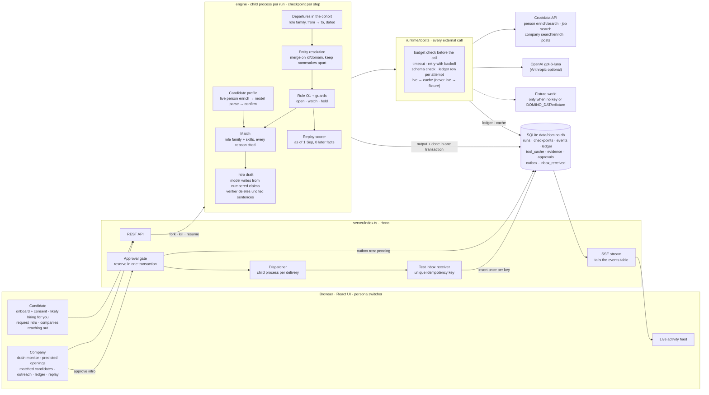

# DOMINO

**A search desk that predicts job openings before they're posted, and makes the match with dated proof.**

When a company loses two of its inference engineers in a quarter and hasn't posted a replacement, it is about to hire.
DOMINO spots that from dated public moves, tells an opted-in candidate "this company is likely hiring for you, and here
is why", and gives the company a matched candidate whose fit is cited line by line. The introduction goes out only
after a person approves it, and it goes **once**.

ContextCon 05 (Crustdata x BITS Pilani), theme "Services, Replaced", problem **1.1 The Search Desk: from a manager's
three lines to a first call, tested on real hires**. Team DOMINO. Built on 22 Nov 2026 between 10:15 and 18:00 IST;
the commit history starts at 12:16 IST.

> **Status, 14:15 IST.** The engine, ledger, verifier, approvals, send-once, replay and Crustdata adapters below are
> built and tested. The two-sided product (candidate onboarding and dashboard, company tabs) and rule O1 are being
> finished this afternoon; the result tables marked *to fill* are completed from the live runs at 16:30.

- [The customer and the service](#the-customer-and-the-service)
- [What you can do with it](#what-you-can-do-with-it)
- [Scope: now and later](#scope-now-and-later)
- [Run it from a fresh clone](#run-it-from-a-fresh-clone)
- [Stack](#stack)
- [Architecture, data, state and hosting](#architecture-data-state-and-hosting)
- [How it decides: rule O1](#how-it-decides-rule-o1)
- [What's live vs cached](#whats-live-vs-cached)
- [Sources, consent, approvals and send-once](#sources-consent-approvals-and-send-once)
- [Privacy](#privacy)
- [Budgets and the cost ledger](#budgets-and-the-cost-ledger)
- [Experiments](#experiments)
- [Robustness cases](#robustness-cases)
- [Limitations and who it could get wrong](#limitations-and-who-it-could-get-wrong)
- [Approaches considered (and why we pivoted)](#approaches-considered-and-why-we-pivoted)
- [Models and tools](#models-and-tools)
- [Next steps](#next-steps)
- [Team and declaration](#team-and-declaration)

## The customer and the service

**The service DOMINO replaces:** a search firm. The handbook puts it plainly: "Recruiting firms earn their fee when a
person starts the job." That fee is large:

| Fee type | Reported range | Source (retrieved 22 Nov 2026) |
|---|---|---|
| Contingency search | "20 percent to 25 percent of the role's first-year cash compensation" | [SHRM, 18 Jul 2016](https://www.shrm.org/in/topics-tools/news/talent-acquisition/how-to-work-effectively-executive-search-firm) |
| Retained search | "about 33 percent of the role's annual salary, bonus and signing bonus" | same SHRM article |
| India, contingency | "between 8.33% and 15% of the candidate's annual CTC" | [Hyring, 24 Aug 2026](https://hyring.com/blog/recruitment-agency-fees-india/) (a vendor's figure) |

These are industry-reported ranges, not audited benchmarks.

**Customers:** the company that pays for the hire, and the candidate, who pays nothing and opts in with their own
profile.

**What the firm actually sells** is timing and proof: knowing a team needs someone before the role is public, and
showing why a particular person fits. Job boards only see an opening once it is posted, and by then every recruiter
and every applicant sees it on the same day. DOMINO looks one step earlier. A company that lost people in a role
family and hasn't replaced them is about to post that role. That is the *second domino*.

## What you can do with it

A persona switcher in the top bar moves between the two sides.

**Candidate (`/candidate`)**

1. **Onboard.** Paste your LinkedIn URL and, optionally, work samples. Tick what you agree to share. DOMINO runs a live
   Crustdata person enrich, the model parses your role family, skills and history, and the profile is shown back to
   you to confirm.
2. **Companies likely hiring for you.** Predicted openings ranked for you. Each has dated reason chips (talent drain,
   no replacement posted, funding or news) and a confidence score.
3. **Request an intro.** You see exactly what the company will receive and confirm it.
4. **Companies reaching out.** An inbox of intro requests from companies.

**Company (`/company/:id`)**

- **Talent-drain monitor:** who left, for where, and when, shown as role, initial and date, never as a full name.
- **Predicted openings:** role family, why, evidence with dates, and status (open, watch, held).
- **Matched candidates:** opted-in candidates only. Each fit reason cites the candidate's consented profile field and
  the opening's evidence. Items DOMINO can't verify are struck through.
- **Outreach:** a sourced intro draft, approved by a person and delivered once to the team inbox. A retry shows
  "already delivered, skipped".
- **Ledger:** credits, tokens, USD and the per-run caps.
- **Replay:** frozen at 1 Sep, predicted openings against the job posts and hires that actually followed, next to the
  baselines.

Agent work stays visible in a live activity feed, but you drive the product by clicking through it.

## Scope: now and later

**Now:**

- Live Crustdata reads: person enrich for the candidate, departures across a cohort of AI companies with their
  previous and new employer, job posts, company enrichment, growth, funding and posts.
- Rule O1 predicts openings, with written guards against false drains. It was fixed at 14:08 IST, after seeing the live
  departure counts and before looking at any replay outcomes (below).
- Matching of a candidate's role family and skills to predicted openings, with every fit reason cited.
- A verifier deletes any sentence in an intro whose numbers, dates or names aren't in the cited evidence. Undated
  facts are listed as "I can't verify" and left out.
- Consent on both sides: the candidate confirms what is shared and requests the intro; a person at the company side
  approves every outreach, and it is delivered once to a test inbox, through retries, double clicks and crashes.
- Per-run credit, model-spend and time caps, lowerable mid-run, and a ledger row per call attempt.
- Kill and resume from the last checkpoint without repeating calls.
- Replay from 1 Sep 2026 against later job posts and hires, with two baselines.

**Later:**

- Crustdata watchers instead of polling, so an opening is flagged on the day of the departure that completes it.
- More role families beyond AI infrastructure (backend, payments, data), and seniority-aware matching.
- A manager's "three lines" as a third input: match the request against predicted *and* posted openings.
- Outcome tracking: first call held, offer, start date, which is when a search firm is paid.
- Real delivery (email, ATS) behind the same approval gate and idempotency key.

## Run it from a fresh clone

Requirements: [Bun](https://bun.sh) 1.2 or newer (`curl -fsSL https://bun.sh/install | bash`, or
`brew install oven-sh/bun/bun`). Nothing else is needed: SQLite is built into Bun.

```bash
git clone https://github.com/Begarudev/domino && cd domino
bun install
bun start            # builds the UI on first run, then serves http://localhost:4321
```

Open <http://localhost:4321>. If port 4321 is taken, `bun start` names the busy port; pick another with
`DOMINO_PORT=4399 bun start`.

**Without API keys**, DOMINO runs on a labelled synthetic fixture world (the data badge reads "Fixture", and the demo
candidate is a labelled fictional person) and writes drafts from an evidence template. Every feature works this way,
including consent, approvals, crash and resume, the ledger and replay. **For live data**, create `.env` in the repo
root. It is gitignored and never committed:

```
CRUSTDATA_API_KEY=...      # live Crustdata reads; with a key the default data mode is live
OPENAI_API_KEY=...         # model-written profile parsing and intro drafts (OPENAI_MODEL, default gpt-6-luna)
ANTHROPIC_API_KEY=...      # optional alternative provider (ANTHROPIC_MODEL, default claude-opus-5-5); used only without an OpenAI key
DOMINO_DATA=live           # optional: live | cache | fixture
DOMINO_PORT=4321           # optional
```

Tests:

```bash
bun run test         # unit, domain and engine tests (bun test server); live-adapter checks skip without a Crustdata key
bun run test:e2e     # end to end over HTTP: messy input, timeouts, kill/resume, double approve, budgets, replay
bun run smoke        # one scripted run: approve twice, kill the engine and resume
bun run typecheck
```

Other scripts: `bun run dev` (hot-reload UI and server), `bun run probe` (checks the live adapters against Crustdata),
`bun run snapshot` (exports cached live responses for an offline demo).

## Stack

| Layer | Choice |
|---|---|
| Runtime, package manager, tests | Bun (TypeScript runs natively; `bun test`) |
| Server | Hono on Bun: REST plus Server-Sent Events. The engine runs as a separate child process per run |
| Frontend | React 19 + Vite, built to static files that the server serves |
| State | SQLite in WAL mode (`data/domino.db`): runs, step checkpoints, append-only events, ledger, tool cache, evidence, approvals, outbox, inbox, asks |
| Data | Crustdata REST API, `x-api-version: 2025-11-01`: `/person/enrich`, `/person/search`, `/job/search`, `/company/search`, `/company/enrich`, `/social_post/search` |
| Models | OpenAI `gpt-6-luna` (reasoning effort none) for profile parsing and the claim-backed middle of each intro; deterministic template fallback; Anthropic `claude-opus-5-5` supported but unused today |
| Validation | zod schemas on every provider response (a nonsense response is rejected and retried) |

## Architecture, data, state and hosting

Rendered by GitHub from [`docs/architecture.mmd`](docs/architecture.mmd) (also on its own page:
[`docs/ARCHITECTURE.md`](docs/ARCHITECTURE.md)):



- **Server** (`server/index.ts`): REST, the SSE stream and the built UI. It never runs pipeline steps itself.
- **Engine** (`server/engine/`): one child process per run. Each step writes its output and its `done` flag in one
  SQLite transaction, so a killed engine resumes at the next step and reuses everything before it.
- **Tool wrapper** (`server/runtime/tool.ts`): the only way out of the process. It checks the budget before each call,
  then applies a timeout, retries with backoff and validates the response schema, and writes a ledger row per attempt.
- **Domain** (`server/domain/`): entity resolution, rule O1 and its guards, matching, the intro verifier and replay
  scoring. Pure functions, unit-tested.
- **Data adapters** (`server/crustdata/`): one spec per endpoint (request builder, parser to dated evidence rows, credit
  estimate). Notes on the API are in [`server/crustdata/NOTES.md`](server/crustdata/NOTES.md).
- **State**: everything lives in SQLite at `data/domino.db`. The UI is rebuilt from the append-only events table, so a
  refresh or a server restart loses nothing.
- **Hosting**: runs locally on the demo laptop (`bun start`). Nothing leaves the machine except Crustdata and model
  API calls. Deliveries go to files under `data/outbox/`.

## How it decides: rule O1

**O1, rule fixed at 14:08 IST, after seeing the live departure counts and before looking at any replay outcomes (posts
after 1 Sep).** We say this plainly: the threshold of 2 was chosen knowing that two companies (Poolside, Abacus.AI) sat
at 2 departures in the live data. The replay is the test it hadn't seen.

> At company A (20–5,000 staff), if there are **2 or more conclusive dated departures** of people in role family F
> within **90 days**, and **no dated replacement hire and no dated job post for F at A within 30 days of the last
> departure**, predict an opening for F at A.

Role families supported first: inference/serving, ML platform and infrastructure, MLOps, and GPU/LLM infrastructure.

**A departure is conclusive** only if both the old and new titles are recognised titles for F (hardware design and
non-engineering titles are excluded outright), the previous role ended at most 60 days before the new one started, and
the dates settle the window.

**False-drain guards.** Any one of these moves the prediction to **Held**, shown with its reason and never matched or
drafted:

- Acquisition or acqui-hire between the two companies (people moving because their company was bought).
- Shared parent, related domains or a configured company family (an internal transfer, not a loss).
- More than 40% of A's headcount moving at once (a team lift or a data error).
- An ambiguous company identity (several candidate records).
- Month-only dates that can't settle the 90- or 30-day window. Crustdata role dates are month-precision, so a month
  that straddles a boundary is held rather than guessed.
- Unrecognised titles.

**Statuses:** *open* (O1 fires), *watch* (one conclusive departure, or a replacement may be in progress), *held* (a
guard tripped).

**Confidence** is written out on every prediction: `base × (1 − 0.5^n) × 2^(−age/30)`, clamped to 0.05–0.95, where
*n* counts the distinct dated rows and *age* is the number of days since the newest row.

**Matching.** A candidate's confirmed role family and skills are matched against open predictions. Every fit reason
cites two things: a consented field from the candidate's profile, and a dated evidence row from the opening. A
reason that can't cite both is struck through as "I can't verify".

**Entity resolution.** One company under two names stays one record (same Crustdata id or domain). Two companies that
share a name stay apart (different domains). Every merge and every split is shown with its matching key.

## What's live vs cached

The data badge in the header always says which world you are in, and every evidence row records its own mode.

| Mode | When | What happens |
|---|---|---|
| **live** | `CRUSTDATA_API_KEY` set (default) | Every read goes to Crustdata. The raw response is cached in `tool_cache` keyed by endpoint and request |
| **cache** (fallback) | a live call times out, errors or returns nonsense after its retries | answered from the cached live response; the feed shows a fallback line and the evidence row says *cached*, with its retrieval time |
| **unavailable** | no cached response either | the source is skipped with a warning; nothing is invented |
| **fixture** | no key, or `DOMINO_DATA=fixture` | a labelled synthetic world for tests and keyless clones. A live run **never** falls back to fixtures |

The live decisions are the candidate's person enrich and opening detection on the live cohort.

## Sources, consent, approvals and send-once

**Sources.** Every evidence row records the endpoint, the record id, the JSON field, the public URL when there is one,
the date the fact happened, when DOMINO retrieved it, and whether it came from live, cache or fixture.

**Intro drafts.** The model never sees raw data. It gets numbered claims built from dated rows and the candidate's
consented fields, and writes only the middle of the intro, citing `[n]`. The verifier then deletes any sentence with a
number, date or name that isn't in the evidence it cites, and lists what it removed. With no model key, intros come
from a deterministic template that goes through the same verifier.

**Consent and approval.** The candidate confirms what is shared and requests the intro. A person on the company side
approves each outreach before it is delivered. DOMINO has no code path that sends real email: delivery writes a file
under `data/outbox/` addressed to a `@domino.invalid` test inbox.

**Send-once, end to end:**

1. The idempotency key is a hash of (run, company, person, message body, kind), fixed when the approval is created.
2. Approving *reserves* the delivery in one SQLite transaction. If the approval was already decided, or an outbox row
   for the key exists, it doesn't reserve again.
3. A separate dispatcher process delivers to the receiver. The receiver inserts into `inbox_received` with the key as
   primary key (`ON CONFLICT DO NOTHING`), so a second delivery of the same key returns `already_delivered`. A
   different message under the same key is refused.
4. If the dispatcher dies after the inbox accepted the message, the outbox row stays `pending` and the feed says so.
   Retrying dispatches again, the receiver answers `already_delivered`, and the row is completed from the original
   receipt. A retry can't produce a second message.
5. The UI shows "already delivered, skipped".

## Privacy

- **Candidates opt in** with their own profile and choose what is shared, field by field. Nothing about a candidate
  reaches a company until the candidate requests the intro, or, on the company side, appears among matches only if
  the candidate opted in to being matched.
- **People who left a company** appear only as role, initial and date ("Inference engineer, P., Sep 2026"), and as
  counts. No full names, no profile links, no contact details.
- **No contact details** are requested for anyone. Only the personal data the job needs is kept.
- **Committed samples are redacted** (names and profile URLs in `docs/sample-run-events.json` read `[redacted]`).
  Live responses are cached on the local machine and never committed.
- The demo candidate is either a real person who consented or a labelled fictional fixture.

## Budgets and the cost ledger

Every run has three ceilings: Crustdata credits, model spend in USD, and wall-clock seconds. You can lower any ceiling
mid-run (`POST /api/runs/:id/limits` or the meters in the UI). The tool wrapper checks the *estimated* cost of each
call **before** making it, and stops with a partial result and status `budget_exhausted` when the next call would
cross a ceiling.

The ledger has one row per **attempt** of every external call, including retries, timeouts, cache hits, fixture reads
and injected failures. Credits come from Crustdata's `X-Credits-Used` header (or the endpoint's rate card when it is
missing). Model rows record input/output tokens and USD at the rate card.

Example from an earlier live run of the same engine (`run_1b4fda05`, 22 Nov, 13:32 IST). Excerpt:

| time (UTC) | step | provider | endpoint | mode | status | attempt | credits | tokens in/out | USD | ms |
|---|---|---|---|---|---|---|---|---|---|---|
| 08:02:26 | parse_request | openai | gpt-5-mini | model | ok | 1 | 0 | 257 / 268 | 0.00060 | 3,781 |
| 08:02:30 | pull_triggers | crustdata | job_search | live | ok | 1 | 2.4 | | | 2,988 |
| 08:02:33 | pull_triggers | crustdata | person_recent_moves | live | ok | 1 | 11.5 | | | 923 |
| 08:02:36 | enrich_companies | crustdata | company_enrich | live | ok | 1 | 30.0 | | | 8,243 |
| 08:02:51 | draft_messages | openai | gpt-5-mini | model | timeout | 1 | 0 | | 0 | 12,001 |
| 08:05:50 | draft_messages | openai | gpt-5-mini | model | ok | 1 | 0 | 295 / 154 | 0.00038 | 2,813 |

That run cost 86.3 credits and $0.0073 over 30 ledger rows in 216 s, including a deliberate kill and resume. Its model
timeouts led us to switch the default model to `gpt-6-luna`. *To fill at 16:30: a ledger excerpt and cost per intro
from the live Search Desk run.*

## Experiments

R1's threshold (3) was fixed before its live count and wasn't changed after. O1's rule was fixed at 14:08 IST, after
seeing the live departure counts and before looking at any replay outcomes. Neither changed after it was fixed.

### 1. Live yield of the talent-drain signal (13:43 IST)

This experiment ran under the earlier Outbound Desk rule R1 (3 departures). The same funnel feeds O1. Full method in
[`docs/YIELD.md`](docs/YIELD.md).

| Funnel step (live Crustdata, 24 Aug – 22 Nov 2026) | Count |
|---|---|
| People with an infra/serving past title and a new role since 24 Aug | 1,410 (1,200 fetched) |
| Direct moves (previous role ended ≤ 60 days before the new one) | 649 |
| ...whose previous role was itself infra/serving | 233 |
| ...from a company with ≤ 5,000 staff | 120 |
| Distinct companies that lost someone | 118 |
| Companies with 2 such departures | **2** |
| Companies with ≥ 3 (R1 fires) | **0** |

The two companies at 2: **Poolside** (2 inference engineers left, both for NVIDIA, Sep 2026) and **Abacus.AI** (2
ML-platform engineers left, Oct and Nov 2026). Under O1 they become candidate openings, provided no replacement hire
or post appears within 30 days and no guard trips.

### 2. O1 on the live cohort

*To fill at 16:30 from the live run:* departures counted, companies with 2 or more conclusive departures, openings
*open* / *watch* / *held* (with the reasons for each hold), and the openings matched to the demo candidate.

### 3. Replay from 1 September

**Protocol (fixed with O1 at 14:08 IST, before any replay outcome was looked at):**

- **As-of date:** 1 Sep 2026. Predictions use only facts dated on or before it ("0 facts dated after 1 Sep" is
  checked and shown). Profile-based moves count only once 30 days old, because people update profiles late.
- **Outcome for O1:** a dated job post or a dated hire for role family F at company A within 60 days after the
  prediction date.
- **Baselines:** (1) companies whose headcount grew 30% or more; (2) companies with any job post in the last 30 days.
- **Reported:** raw counts per arm (predicted, showed the opening, did not), with no lift statistics. Small numbers
  stay small, including when DOMINO loses.
- **Caveat (also on screen):** not point-in-time. It is today's Crustdata index filtered by fact dates, so records
  that changed or disappeared since 1 Sep can't be seen.

| Arm | Predicted | Opening appeared | Did not |
|---|---|---|---|
| O1 | *to fill* | | |
| Headcount +30% | *to fill* | | |
| Any job post in the last 30 days | *to fill* | | |

## Robustness cases

| Case | What happens |
|---|---|
| Messy or partial profile (no skills listed, odd titles) | parsed into a role family with the assumption shown for the candidate to confirm or fix |
| LinkedIn URL that Crustdata can't find | "I can't verify this profile"; the candidate can continue with a manual profile, marked as unverified |
| Tool timeout | retried with backoff and shown in the feed (injected faults only with `?chaos`, labelled as injected) |
| Tool returns nonsense | the schema check rejects it; retried and logged |
| Live call keeps failing | answered from the cached live response with a visible fallback line; never from fixtures |
| Same company, two names | merged, with the matching key shown |
| Same name, different companies | kept apart, with the reason |
| Acqui-hire, internal transfer, team lift | held with the reason, never matched |
| Undated claim | "I can't verify", struck through and kept out of the intro |
| Engine killed mid-run | resumes from the last checkpoint; no repeated calls or sends |
| Approve twice, or retry after a crash | "already delivered, skipped" |
| Budget lowered mid-run | stops before the next paid call with a partial result |

## Limitations and who it could get wrong

- **A drain that isn't one.** People leave because of a re-org, a deliberately smaller team, or a sabbatical, and a
  company may decide not to backfill. Every prediction shows that competing explanation, and nothing goes out without
  a person's approval.
- **Late profile updates.** People change their profiles weeks after they move, so live windows miss some moves and
  replay adds a 30-day lag. Month-only dates near a boundary are held rather than guessed.
- **Replacements we can't see.** A replacement hired through a referral, or a role filled internally, may not show up
  in public data, so O1 could predict an opening that was already filled.
- **Thin signal.** Drains of several people in one role family are rare in public data (2 companies at 2 departures in
  the quarter we measured).
- **Coverage bias.** Companies and people with sparse public profiles (many small Indian startups) produce fewer dated
  rows, so DOMINO says less about them instead of guessing. Candidates with thin profiles get fewer matches.
- **Replay isn't point-in-time** (see the caveat above).
- **No real delivery.** By design, everything goes to a local test inbox.

## Approaches considered (and why we pivoted)

**First version: an Outbound Desk for AI-infrastructure vendors (theme 9.1).** The same engine looked for needs
created by another company's move. Its main rule, **R1 TALENT_DRAIN**, said: if B hires 3 or more of A's serving
engineers within 90 days, the 3rd in the last 30, then A has lost the people who run its inference and should buy
managed inference. CONTAGION (a peer's infra moves) and DISPLACEMENT (a provider acquired or shut down) sat alongside
a first-order hiring baseline. It ran end to end on live data: request, live Crustdata reads, cascade, decider,
verified draft, approval, send-once.

**The honest zero.** At 13:43 we measured R1's live yield with the threshold fixed beforehand: 1,410 departures came
down to **0** accounts at 3 departures and 2 at 2 (Poolside, Abacus.AI). We didn't lower the threshold after seeing
the count; we put the two accounts on a watchlist. Live drafts came from CONTAGION, the weakest mechanism, and a first
replay from 1 Sep produced no cross-company edges at all (5 picks, all from the hiring baseline; 2 of them showed the
need, against 13 of 34 for the hiring filter).

**Why we pivoted (14:08).** The talent-drain signal itself was real and dated. It was attached to the wrong buyer: a
vendor's need for inference is a weak inference from two departures, but a team's need to **replace two engineers** is
direct. Recruiting is also where the money is paid at a clear moment (a start date), and the outcome can be checked
against later job posts and hires. So we kept the engine, the guards, the verifier, send-once and the replay, and
moved the signal to the Search Desk.

| Approach | Why not, or why |
|---|---|
| A job-board scraper that matches candidates to posted roles | Sees an opening only when everyone else does; no edge on timing |
| A chat agent that browses profiles and writes intros | Can't prove where each fact came from or that an intro was sent once |
| An LLM ranking companies and candidates | Not reproducible and can't be replayed honestly |
| Outbound Desk with R1/CONTAGION/DISPLACEMENT (built first) | Worked end to end, but R1 yielded 0 at its pre-set threshold and the vendor need was indirect |
| Lowering R1 to 2 after seeing 0 | Rejected: a threshold tuned to the data it is scored on proves nothing |
| **Search Desk: O1 on dated departures, opted-in candidates, cited matches, approval and send-once, replay (chosen)** | The signal maps directly to a hire, the outcome is checkable, and every decision is explainable |

The Outbound Desk demo script is kept in [`docs/DEMO-outbound.md`](docs/DEMO-outbound.md).

## Models and tools

- **OpenAI `gpt-6-luna`** (reasoning effort none): parses the candidate profile into a role family and skills, and
  writes the cited middle of each intro. Every call is on the ledger with its timeout and attempts.
- **Deterministic template**: intros when no model key is set or the model keeps failing; it goes through the same
  verifier.
- **Anthropic `claude-opus-5-5`**: supported provider, used only when it is the only key set (not used today).
- **Crustdata REST API**: all live data (see [Stack](#stack)).
- **Built with** Bun, Hono, React, Vite, SQLite and zod, using AI coding tools (Claude Code and OpenAI Codex) under the
  team's direction.

## Next steps

1. Crustdata watchers on the cohort, so an opening is flagged the day its second departure lands.
2. The manager's three lines as an input, so DOMINO matches a request against predicted and posted openings at once.
3. Replays over several as-of dates, enough to compare O1 with the baselines on more than a handful of companies, with
   confidence learned from them.
4. Outcome tracking through to a start date, which is when a search firm gets paid.

## Team and declaration

Team **DOMINO**, ContextCon 05, BITS Pilani, 22 Nov 2026.

**Prepared before 10:15 IST:** the DOMINO idea document (text only). No code, prompts or designs were prepared
beforehand. All code, prompts and designs in this repository were written on 22 Nov 2026 after 10:15 IST, with AI
coding tools; the commit history starts at 12:16 IST.
