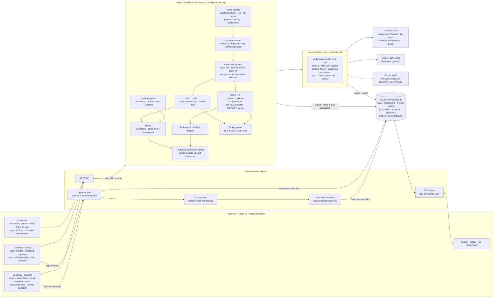

# DOMINO

**One product, two parts, built on one signal: dated moves between companies.**

1. **Hiring: a search desk that predicts job openings before they're posted, and makes the match with dated proof.**
   When a company loses two of its inference engineers in a quarter and hasn't posted a replacement, it is about to
   hire. DOMINO tells an opted-in candidate "this company is likely hiring for you, and here is why", and gives the
   company a matched candidate whose fit is cited line by line.
2. **Company analysis: what changed at a company, and what it will need next.** News, talent flows, cross-company
   chains (talent drain, contagion, displacement), predicted needs, and verified outreach to the person who decides.

Every claim cites a dated source. Nothing goes out until a person approves it, and then it goes **once**.

ContextCon 05 (Crustdata x BITS Pilani), theme "Services, Replaced". Primary problem **1.1 The Search Desk**, combined
with **9.1 The Outbound Desk** for the company-analysis part (the handbook allows combining themes). Team DOMINO.
Built on 22 Nov 2026 between 10:15 and 18:00 IST; the commit history starts at 12:16 IST.

> **Status, 14:30 IST.** The company-analysis engine (rules, verifier, approvals, send-once, ledger, replay, Crustdata
> adapters) is built and tested. Rule O1 has run on live data and on the 1 Sep replay (numbers below, details in
> [`docs/LIVE-DATA.md`](docs/LIVE-DATA.md)). The hiring screens (candidate onboarding and dashboard, company hiring
> tabs) are being finished this afternoon; items marked *to fill* are completed at 16:30.

- [The customer and the service](#the-customer-and-the-service)
- [What you can do with it](#what-you-can-do-with-it)
- [Scope: now and later](#scope-now-and-later)
- [Run it from a fresh clone](#run-it-from-a-fresh-clone)
- [Stack](#stack)
- [Architecture, data, state and hosting](#architecture-data-state-and-hosting)
- [How it decides](#how-it-decides)
- [What's live vs cached](#whats-live-vs-cached)
- [Sources, consent, approvals and send-once](#sources-consent-approvals-and-send-once)
- [Privacy](#privacy)
- [Budgets and the cost ledger](#budgets-and-the-cost-ledger)
- [Experiments](#experiments)
- [Robustness cases](#robustness-cases)
- [Limitations and who it could get wrong](#limitations-and-who-it-could-get-wrong)
- [Approaches considered](#approaches-considered)
- [Models and tools](#models-and-tools)
- [Next steps](#next-steps)
- [Team and declaration](#team-and-declaration)

## The customer and the service

DOMINO replaces two paid services that do the same research: watch what changes between companies, work out who now
has a need, and prove it.

**1. A search firm (hiring).** The handbook puts it plainly: "Recruiting firms earn their fee when a person starts the
job." That fee is large:

| Fee type | Reported range | Source (retrieved 22 Nov 2026) |
|---|---|---|
| Contingency search | "20 percent to 25 percent of the role's first-year cash compensation" | [SHRM, 18 Jul 2016](https://www.shrm.org/in/topics-tools/news/talent-acquisition/how-to-work-effectively-executive-search-firm) |
| Retained search | "about 33 percent of the role's annual salary, bonus and signing bonus" | same SHRM article |
| India, contingency | "between 8.33% and 15% of the candidate's annual CTC" | [Hyring, 24 Aug 2026](https://hyring.com/blog/recruitment-agency-fees-india/) (a vendor's figure) |

These are industry-reported ranges, not audited benchmarks. The customers are the company that pays for the hire and
the candidate, who pays nothing and opts in with their own profile. What the firm actually sells is timing and proof.
Job boards see an opening only once it is posted, the same day as every recruiter and applicant. DOMINO looks one step
earlier: a company that lost people in a role family and hasn't replaced them is about to post that role.

**2. A sales development or research agency (company analysis).** These firms are paid per meeting booked with the
right buyer, and most of them watch one trigger, a company's own hiring ("X posts an inference role, so X needs
inference"). DOMINO looks for needs that **another company's move created**. If B hires three of A's serving
engineers, A has just lost the people who run its inference and hasn't posted a role yet. A hiring filter can't see
that.

The same dated departures drive both parts. A team that loses two engineers needs to **replace** them (part 1), and a
company that loses its serving team may need to **buy** what it can no longer build (part 2).

## What you can do with it

A persona switcher in the top bar moves between the candidate and company views. Agent work stays visible in a live
activity feed, but you drive the product by clicking through features.

### Part 1: Hiring

**Candidate (`/candidate`)**

1. **Onboard.** Paste your LinkedIn URL and, optionally, work samples. Tick what you agree to share. DOMINO runs a live
   Crustdata person enrich, the model parses your role family, skills and history, and the profile is shown back to
   you to confirm.
2. **Companies likely hiring for you.** Predicted openings ranked for you. Each has dated reason chips (talent drain,
   no replacement posted, funding or news) and a confidence score.
3. **Request an intro.** You see exactly what the company will receive and confirm it.
4. **Companies reaching out.** An inbox of intro requests from companies.

**Company hiring tabs (`/company/:id`)**

- **Talent-drain monitor:** who left, for where, and when, shown as role, initial and date, never as a full name.
- **Predicted openings:** role family, why, evidence with dates, and status (open, provisional, watch, held).
- **Matched candidates:** opted-in candidates only. Each fit reason cites the candidate's consented profile field and
  the opening's evidence. Items DOMINO can't verify are struck through.
- **Outreach:** a sourced intro draft, approved by a person and delivered once to the team inbox. A retry shows
  "already delivered, skipped".

### Part 2: Company analysis

- **News and talent flows:** dated company posts and news, headcount growth and funding, and where people went and
  came from (as counts and roles).
- **Cross-company chains:** the cascade of edges between companies (talent drain, contagion, displacement), each with
  its dated evidence, a confidence, and the competing explanation it couldn't rule out. A hiring-filter view dims
  everything a first-order tool would also have found.
- **Predicted needs:** ranked accounts, the need each one now has, and the person who decides there, from public work
  history.
- **Verified outreach:** a first message where every claim cites `[n]`, a verifier that deletes uncited sentences, an
  "I can't verify" list, and a meeting hold, delivered once after approval.

### Shared

- **Ledger:** credits, tokens, USD and the per-run caps, lowerable mid-run.
- **Replay:** frozen at 1 Sep, predictions scored against what happened next, next to baselines.

## Scope: now and later

**Now:**

- Live Crustdata reads: person enrich for the candidate, departures across a cohort of AI companies with their
  previous and new employer, job posts, company enrichment, growth, funding and posts.
- Rule O1 predicts openings; rules R1, CONTAGION and DISPLACEMENT predict company needs, next to a first-order hiring
  baseline. All share the same false-drain guards.
- Matching of a candidate's role family and skills to predicted openings, with every fit reason cited.
- A verifier deletes any sentence in an intro or outreach message whose numbers, dates or names aren't in the cited
  evidence. Undated facts are listed as "I can't verify" and left out.
- Consent on both sides. The candidate confirms what is shared and requests the intro, and a person approves every
  outreach. Each delivery goes once to a test inbox, through retries, double clicks and crashes.
- Per-run credit, model-spend and time caps, lowerable mid-run, and a ledger row per call attempt.
- Kill and resume from the last checkpoint without repeating calls.
- Replay from 1 Sep 2026 with baselines, for both parts.

**Later:**

- Crustdata watchers instead of polling, so an opening or a need is flagged on the day the deciding move lands.
- More role families (backend, payments, data) and seniority-aware matching.
- A manager's "three lines" as a third input, matched against predicted *and* posted openings.
- More cross-company rules (vendor churn, customer concentration, a key customer's funding).
- Outcome tracking: first call, offer and start date for hiring, and meeting held for outreach.
- Real delivery (email, ATS, calendar) behind the same approval gate and idempotency key.

## Run it from a fresh clone

Requirements: [Bun](https://bun.sh) 1.2 or newer (`curl -fsSL https://bun.sh/install | bash`, or
`brew install oven-sh/bun/bun`). Nothing else is needed: SQLite is built into Bun.

```bash
git clone https://github.com/Begarudev/domino && cd domino
bun install
bun start            # builds the UI on first run, then serves http://localhost:4321
```

Open <http://localhost:4321>. If port 4321 is taken, `bun start` names the busy port; pick another with
`DOMINO_PORT=4399 bun start`.

**Without API keys**, DOMINO runs on a labelled synthetic fixture world (the data badge reads "Fixture", and the demo
candidate is a labelled fictional person) and writes drafts from an evidence template. Every feature works this way,
including consent, approvals, crash and resume, the ledger and replay. **For live data**, create `.env` in the repo
root. It is gitignored and never committed:

```
CRUSTDATA_API_KEY=...      # live Crustdata reads; with a key the default data mode is live
OPENAI_API_KEY=...         # model-written parsing and drafts (OPENAI_MODEL, default gpt-6-luna)
ANTHROPIC_API_KEY=...      # optional alternative provider (ANTHROPIC_MODEL, default claude-opus-5-5); used only without an OpenAI key
DOMINO_DATA=live           # optional: live | cache | fixture
DOMINO_PORT=4321           # optional
```

Tests:

```bash
bun run test         # unit, domain and engine tests (bun test server); live-adapter checks skip without a Crustdata key
bun run test:e2e     # end to end over HTTP: messy input, timeouts, kill/resume, double approve, budgets, replay
bun run smoke        # one scripted run: approve twice, kill the engine and resume
bun run typecheck
```

Other scripts: `bun run dev` (hot-reload UI and server), `bun run probe` (checks the live adapters against Crustdata),
`bun run snapshot` (exports cached live responses for an offline demo).

## Stack

| Layer | Choice |
|---|---|
| Runtime, package manager, tests | Bun (TypeScript runs natively; `bun test`) |
| Server | Hono on Bun: REST plus Server-Sent Events. The engine runs as a separate child process per run |
| Frontend | React 19 + Vite, built to static files that the server serves |
| State | SQLite in WAL mode (`data/domino.db`): runs, step checkpoints, append-only events, ledger, tool cache, evidence, approvals, outbox, inbox, asks |
| Data | Crustdata REST API, `x-api-version: 2025-11-01`: person enrich and search, `/job/search`, `/company/search`, `/company/enrich`, `/social_post/search` |
| Models | OpenAI `gpt-6-luna` (reasoning effort none) for parsing requests and profiles and the claim-backed middle of each message; deterministic template fallback; Anthropic `claude-opus-5-5` supported but unused today |
| Validation | zod schemas on every provider response (a nonsense response is rejected and retried) |

## Architecture, data, state and hosting

Rendered by GitHub from [`docs/architecture.mmd`](docs/architecture.mmd) (also on its own page:
[`docs/ARCHITECTURE.md`](docs/ARCHITECTURE.md)):



- **Server** (`server/index.ts`): REST, the SSE stream and the built UI. It never runs pipeline steps itself.
- **Engine** (`server/engine/`): one child process per run. Each step writes its output and its `done` flag in one
  SQLite transaction, so a killed engine resumes at the next step and reuses everything before it.
- **Tool wrapper** (`server/runtime/tool.ts`): the only way out of the process. It checks the budget before each call,
  then applies a timeout, retries with backoff and validates the response schema, and writes a ledger row per attempt.
- **Domain** (`server/domain/`): entity resolution, the rules and their guards, matching, ranking, deciders, the
  verifier and replay scoring. Pure functions, unit-tested.
- **Data adapters** (`server/crustdata/`): one spec per endpoint (request builder, parser to dated evidence rows, credit
  estimate). Notes on the API are in [`server/crustdata/NOTES.md`](server/crustdata/NOTES.md).
- **State**: everything lives in SQLite at `data/domino.db`. The UI is rebuilt from the append-only events table, so a
  refresh or a server restart loses nothing.
- **Hosting**: runs locally on the demo laptop (`bun start`). Nothing leaves the machine except Crustdata and model
  API calls. Deliveries go to files under `data/outbox/`.

## How it decides

Every rule needs **at least two dated, verifiable evidence rows**. Facts without dates never count. Every prediction
and every edge carries its evidence, a confidence, a one-line rationale, and the competing explanation it couldn't
rule out.

### Shared: conclusive departures, guards and date precision

**A departure is conclusive** only if both the old and new titles are recognised titles for the role family (hardware
design and non-engineering titles are excluded outright), the previous role ended at most 60 days before the new one
started, and the dates settle the window. Role families supported first: inference/serving, ML platform and
infrastructure, MLOps, and GPU/LLM infrastructure. Companies over 5,000 staff are excluded as the losing side.

**False-drain guards.** Any one of these moves a prediction to **Held**, shown with its reason and never matched or
drafted:

- Acquisition or acqui-hire between the two companies (people moving because their company was bought).
- Shared parent, related domains or a configured company family (an internal transfer, not a loss).
- More than 40% of the company's headcount moving at once (a team lift or a data error).
- An ambiguous company identity (several candidate records).
- Departures whose month-level dates straddle the drain window (below).
- Unrecognised titles.

**Date precision.** Every Crustdata role date is month-level: `2026-10-01` means "some day in October". DOMINO treats a
month-only date as an interval from the 1st to the last day of the month. A condition counts as *settled* only if it
holds for every possible day in those intervals:

- If departures may or may not fall inside the drain window, the prediction is **held**.
- If O1's 30-day no-replacement window can't be settled yet, DOMINO shows a **predicted opening (provisional), window
  closes by &lt;date&gt;**, where the date is the last possible day of the window. It becomes *open* once that date
  passes with no dated replacement hire or job post. If one appears, the prediction is withdrawn.

This guard was refined from a strict "any month-only date near a boundary → hold" at **14:14 IST**, after seeing the
live departure counts and before looking at any replay outcomes. The reason: on month-level data the strict reading
holds almost everything, which makes the rules vacuous.

**Confidence**, written out on every prediction and edge: `base × (1 − 0.5^n) × 2^(−age/30)`, clamped to 0.05–0.95,
where *n* counts the distinct dated rows and *age* is the number of days since the newest row.

**Entity resolution.** One company under two names stays one record (same Crustdata id or domain). Two companies that
share a name stay apart (different domains). Every merge and every split is shown with its matching key.

### Part 1: rule O1, predicted openings

**Rule fixed at 14:08 IST, after seeing the live departure counts and before looking at any replay outcomes (posts
after 1 Sep).** We say this plainly: the threshold of 2 was chosen knowing that two companies (Poolside, Abacus.AI) sat
at 2 departures in the live data. The replay is the test it hadn't seen.

> At company A (20–5,000 staff), if there are **2 or more conclusive dated departures** of people in role family F
> within **90 days**, and **no dated replacement hire and no dated job post for F at A within 30 days of the last
> departure**, predict an opening for F at A.

**Statuses:** *open* (O1 fires and every window is settled), *provisional* (O1 fires but the no-replacement window
closes on a stated date), *watch* (one conclusive departure, or a replacement may be in progress), *held* (a guard
tripped).

**Matching.** A candidate's confirmed role family and skills are matched against open and provisional predictions.
Every fit reason cites two things: a consented field from the candidate's profile, and a dated evidence row from the
opening. A reason that can't cite both is struck through as "I can't verify".

### Part 2: cross-company chains, predicted needs

Each rule produces an **edge** from the company whose move caused the need to the company that now has it.

**R1 TALENT_DRAIN** (threshold fixed before its 13:43 live count). B hired **3 or more** of A's serving engineers
within 90 days, with the 3rd inside the last 30 days, so A must buy capacity or help instead of rebuilding in-house.
The shared guards apply. An account at 2 of 3 goes on a **watchlist** with its dated evidence and is never drafted.

**DISPLACEMENT.** An inference provider was acquired, shut down or repriced (a dated source), and B's dated job posts
name that provider's product, so B needs a contingency plan for the integration. Displacement events are configured
per seller in `config/seller.json` with their source URL and date, and must match the post's product field exactly.
Two real, dated events are configured: **Hugging Face acquired by NVIDIA** (3 Sep 2026,
[blogs.nvidia.com](https://blogs.nvidia.com/blog/nvidia-to-acquire-hugging-face/); product: Text Generation Inference)
and **Chroma Cloud shut down** (23 Oct 2026, [trychroma.com](https://trychroma.com/blog/replit)). A third, Lumen Serve,
is a labelled fixture used only in tests.

**CONTAGION.** A peer of B (same industry and size band within 3x, or a listed competitor) made dated technical moves
(at least two infra job posts or relevant hires), and B has posted no matching roles. B is likely to face the same
scaling problem next. Held accounts, related domains, companies already hiring, giants and staffing firms are
excluded, with at most 3 peers per source. The peer reason is shown on the edge ("same segment, 50–75 staff").

**DIRECT (the baseline).** B posts infra roles itself. This *is* the first-order hiring filter, kept to compare
against. Every account shows whether the hiring filter would have found it.

Mechanism bases for the confidence formula: talent drain 0.98, displacement 0.95, contagion 0.86, direct 0.74, plus
0.05 when there is dated funding. **Ranking** multiplies confidence by industry fit, size fit (20–2,000 staff) and a
45-day recency decay. One decider per account comes from public work history.

## What's live vs cached

The data badge in the header always says which world you are in, and every evidence row records its own mode.

| Mode | When | What happens |
|---|---|---|
| **live** | `CRUSTDATA_API_KEY` set (default) | Every read goes to Crustdata. The raw response is cached in `tool_cache` keyed by endpoint and request |
| **cache** (fallback) | a live call times out, errors or returns nonsense after its retries | answered from the cached live response; the feed shows a fallback line and the evidence row says *cached*, with its retrieval time |
| **unavailable** | no cached response either | the source is skipped with a warning; nothing is invented |
| **fixture** | no key, or `DOMINO_DATA=fixture` | a labelled synthetic world for tests and keyless clones. A live run **never** falls back to fixtures |

The live decisions are the candidate's person enrich, opening detection on the live cohort, and the company-analysis
rules on live Crustdata reads.

## Sources, consent, approvals and send-once

**Sources.** Every evidence row records the endpoint, the record id, the JSON field, the public URL when there is one,
the date the fact happened, when DOMINO retrieved it, and whether it came from live, cache or fixture. Messages cite
rows as `[n]`, and hovering a citation lights up its row in the evidence drawer.

**Drafts (intros and outreach).** The model never sees raw data. It gets numbered claims built from dated rows (and,
for intros, the candidate's consented fields) and writes only the middle of the message, citing `[n]`. The greeting,
the ask and the sign-off are fixed copy. The verifier then deletes any sentence with a number, date or name that isn't
in the evidence it cites, and lists what it removed. With no model key, drafts come from a deterministic template that
goes through the same verifier.

**Consent and approval.** The candidate confirms what is shared and requests the intro. A person approves each
outreach (an intro, or a message plus a meeting hold) before delivery. DOMINO has no code path that sends real email or
invites: delivery writes `.eml` / `.ics` files under `data/outbox/` addressed to a `@domino.invalid` test inbox.

**Send-once, end to end:**

1. The idempotency key is a hash of (run, company, person, message body, kind), fixed when the approval is created.
2. Approving *reserves* the delivery in one SQLite transaction. If the approval was already decided, or an outbox row
   for the key exists, it doesn't reserve again.
3. A separate dispatcher process delivers to the receiver. The receiver inserts into `inbox_received` with the key as
   primary key (`ON CONFLICT DO NOTHING`), so a second delivery of the same key returns `already_delivered`. A
   different message under the same key is refused.
4. If the dispatcher dies after the inbox accepted the message, the outbox row stays `pending` and the feed says so.
   Retrying dispatches again, the receiver answers `already_delivered`, and the row is completed from the original
   receipt. A retry can't produce a second message.
5. The UI shows "already delivered, skipped".

## Privacy

- **Candidates opt in** with their own profile and choose what is shared, field by field. Nothing about a candidate
  reaches a company until the candidate requests the intro, or, on the company side, appears among matches only if
  the candidate opted in to being matched.
- **People who left a company** appear only as role, initial and date ("Inference engineer, P., Sep 2026"), and as
  counts. No full names, no profile links, no contact details.
- **Company analysis** keeps one decision-maker per account (name, title, employer, role dates, public profile URL),
  from public work history.
- **No contact details** are requested for anyone. Only the personal data the job needs is kept.
- **Committed samples are redacted** (names and profile URLs in `docs/sample-run-events.json` read `[redacted]`).
  Live responses are cached on the local machine and never committed.
- The demo candidate is either a real person who consented or a labelled fictional fixture.

## Budgets and the cost ledger

Every run has three ceilings: Crustdata credits, model spend in USD, and wall-clock seconds. You can lower any ceiling
mid-run (`POST /api/runs/:id/limits` or the meters in the UI). The tool wrapper checks the *estimated* cost of each
call **before** making it, and stops with a partial result and status `budget_exhausted` when the next call would
cross a ceiling.

The ledger has one row per **attempt** of every external call, including retries, timeouts, cache hits, fixture reads
and injected failures. Credits come from Crustdata's `X-Credits-Used` header (or the endpoint's rate card when it is
missing). Model rows record input/output tokens and USD at the rate card.

Example: live company-analysis run `run_1b4fda05` (22 Nov, 13:32 IST). Excerpt:

| time (UTC) | step | provider | endpoint | mode | status | attempt | credits | tokens in/out | USD | ms |
|---|---|---|---|---|---|---|---|---|---|---|
| 08:02:26 | parse_request | openai | gpt-5-mini | model | ok | 1 | 0 | 257 / 268 | 0.00060 | 3,781 |
| 08:02:30 | pull_triggers | crustdata | job_search | live | ok | 1 | 2.4 | | | 2,988 |
| 08:02:33 | pull_triggers | crustdata | person_recent_moves | live | ok | 1 | 11.5 | | | 923 |
| 08:02:34 | pull_triggers | crustdata | company_growth | live | ok | 1 | 41.0 | | | 2,223 |
| 08:02:36 | enrich_companies | crustdata | company_enrich | live | ok | 1 | 30.0 | | | 8,243 |
| 08:02:51 | draft_messages | openai | gpt-5-mini | model | timeout | 1 | 0 | | 0 | 12,001 |
| 08:05:50 | draft_messages | openai | gpt-5-mini | model | ok | 1 | 0 | 295 / 154 | 0.00038 | 2,813 |

That run cost **86.3 credits and $0.0073** over 30 ledger rows in 216 s, including a deliberate kill and resume. Its
model timeouts led us to switch the default model to `gpt-6-luna`. The live O1 funnel, its replay and their checks
used about 1,559 credits, each figure summed from the `x-credits-used` header ([`docs/LIVE-DATA.md`](docs/LIVE-DATA.md)).
*To fill at 16:30: a ledger excerpt and the cost per intro from a live hiring run.*

## Experiments

R1's threshold (3) was fixed before its live count and wasn't changed after. O1's rule was fixed at 14:08 IST, after
seeing the live departure counts and before looking at any replay outcomes. Its month-date guard was refined to interval
semantics at 14:14 IST, also before any replay outcome was read. Nothing changed after that.

### 1. Live talent-drain funnel

The same departures feed R1 and O1. Live Crustdata reads on 22 Nov 2026, 13:50–14:40 IST, all 1,410 profiles fetched.
Method, filters and endpoints: [`docs/LIVE-DATA.md`](docs/LIVE-DATA.md) (the 13:43 partial count of 1,200 profiles is
in [`docs/YIELD.md`](docs/YIELD.md)).

| Funnel step (live Crustdata, 24 Aug – 22 Nov 2026) | Count |
|---|---|
| People with an infra/serving past title and a new role since 24 Aug | 1,410 |
| Direct moves (previous role ended ≤ 60 days before the new one) | 770 |
| ...whose previous role was itself infra/serving | 289 |
| ...from a company with ≤ 5,000 staff | 151 |
| Distinct companies that lost someone | 148 |
| Companies with 2 or more such departures | **3** (Poolside, Abacus.AI, Multiverse Computing) |
| Companies losing 3 or more to one hirer, the 3rd in the last 30 days (R1 fires) | **0** |

**The honest zero.** R1 fires on **0** accounts this quarter. We kept its threshold at 3 rather than lowering it after
seeing the count, because a rule tuned to the data it is scored on proves nothing. In part 2 the companies at 2 go on
the watchlist and are never drafted. In part 1 the same departures are what O1 reads.

What we learned: Crustdata role dates are month-level, so windows can only be settled when the whole month is inside
them (which led to the interval semantics above). Drains of three or more serving engineers from one company in a
quarter are rare in public data. And the first query returned zero because it combined filters that matched nothing;
counting the funnel step by step found it.

### 2. Part 1: O1 on the live cohort

Every one of the 28,666 role dates in the live pull falls on the 1st of a month, which is why the interval semantics
matter.

| O1 step (live) | Count |
|---|---|
| Profiles | 1,410 |
| Departures in a supported role family (engineering title, direct move) | 281 |
| ...conclusive inside the 90-day window | 176 |
| Company × role-family groups | 238 (103 at 20–5,000 staff) |
| Groups at 20–5,000 staff with 2 or more departures | 4 |
| ...with 2 or more *conclusive* departures | 2 |
| **Predicted openings** | **1, provisional** |
| **Held** | **2** (plus one group outside the window) |

- **Predicted opening (provisional): Abacus.AI (288 staff), ML platform; window closes by 30 Nov 2026.** P., ML
  Platform Engineer, left in Oct 2026 for Arcfront. P., ML Platform Engineer, left in Oct 2026 for Bravebird (started
  Nov). A third departure (Y., Aug 2026) isn't counted because August straddles the window start. No replacement: job
  search for Abacus.AI ML-platform, infra and MLOps titles from 1 Oct to 22 Nov returned 0, and person search for an
  ML-platform hire starting since 1 Oct returned 0 (checked 22 Nov). Abacus.AI's only posts since 1 Oct are six
  "Forward Deployed Engineer" listings, outside the family.
- **Held, acqui-hire: Poolside (302 staff), inference.** L. and A., both inference engineers, left in Sep 2026 for
  NVIDIA. A dated article found through Crustdata news search, "Nvidia pays Poolside $6bn to license its model factory
  and hire 109 staff" ([The Next Web](https://thenextweb.com/news/nvidia-poolside-6bn-model-factory-licence),
  published 21 Aug 2026), shows this is an acqui-hire, not a drain. This hold comes from the live analysis scripts
  (`scripts/live/`, recorded in `docs/LIVE-DATA.md`). The app's automatic news check for acqui-hires isn't merged yet;
  in the app today, an acquisition is held when it is in the configured or enriched acquisition records.
- **Held, dates can't settle the window: SANI (34 staff), ML platform**, because of August month-only dates.
- Multiverse Computing's departures ended in July, outside the 90 days. Every other group with 2 or more departures
  is above 5,000 staff (Intel, Google, Meta, Microsoft, Oracle, Qualcomm, AWS, Apple, Optum, TikTok).

*To fill at 16:30:* the openings matched to the demo candidate, and the same counts from the app's own live run.

### 3. Part 2: live company-analysis run

`run_1b4fda05` (13:32 IST): 214 triggers from 363 dated evidence rows, 125 canonical companies after 22 merges,
20 cascade edges (all CONTAGION, before CONTAGION's peer selection was tightened), **5 ranked accounts**:

| Account | Rule | Hiring filter would find it? |
|---|---|---|
| Arrive AI | CONTAGION (+ dated funding) | no |
| ChronoScale | CONTAGION (+ dated funding) | no |
| Linq | CONTAGION (+ dated funding) | no |
| PaleBlueDot AI | CONTAGION | no |
| Bright Vision Technologies | DIRECT (baseline) | yes |

3 decision-makers found, 5 verified drafts, 10 approvals queued (a message and a meeting hold each), 86.3 credits,
$0.0073, 216 s. *To refresh at 16:30 after the CONTAGION tightening.*

### 4. Replay from 1 September

**Protocol:**

- **As-of date:** 1 Sep 2026. Predictions use only facts dated on or before it ("0 facts dated after 1 Sep" is
  checked and shown). Profile-based moves count only once 30 days old, because people update profiles late.
- **Outcome, part 1 (O1):** a dated job post or a dated hire for role family F at company A within 60 days after the
  prediction date. Baselines: companies whose headcount grew 30% or more, and companies with any job post in the last
  30 days. Fixed at 14:08 IST, before any replay outcome was looked at.
- **Outcome, part 2:** within 60 days, a dated serving, infra or ML-platform job post or hire at the account. The
  account *showed* the need; we never claim it bought anything. Baselines: the first-order hiring filter and headcount
  +30%. Frozen at 13:40 IST, before any replay outcome was looked at.
- **Reported:** raw counts per arm (predicted, outcome appeared, did not), with no lift statistics. Small numbers stay
  small, including when DOMINO loses.
- **Caveat (also on screen):** not point-in-time. It is today's Crustdata index filtered by fact dates, so records
  that changed or disappeared since 1 Sep can't be seen.

**Part 1 (O1)**: live-cached snapshot retrieved 22 Nov 2026 14:08–14:17 IST, 2,456 profiles, **0 facts dated after
1 Sep**. The outcome is a dated job post or hire in an infra/serving role family at the company in (1 Sep, 31 Oct], the
same for every arm. O1 is scored on its own family F.

| Arm | Picks | Outcome appeared by 31 Oct | Did not |
|---|---|---|---|
| O1 | **0** predicted (1 held) | 0 | 0 |
| Any job post in the last 30 days (2 Aug – 1 Sep) | 70 | 10 | 60 |
| Headcount +30% (monthly, enrich timeseries as of 1 Sep) | 0 | 0 | 0 |
| Every company in the cohort (20–5,000 staff, ≥ 1 family departure) | 118 | 10 | 108 |

**O1 didn't fire as of 1 Sep.** With month-level dates and the 30-day profile lag, only departures that ended in July
could be conclusive, and no company at 20–5,000 staff had two. The one hold was Clarifai (46 staff, MLOps): 3
departures, but the June month-only dates straddle the window start. So this replay can't show O1 beating a baseline
on this cohort, and we say so. For scale, 10 of the 118 cohort companies (8%) showed an infra opening in the next two
months, and 10 of the 70 recently-hiring companies did (14%). Files: `docs/live/replay-2026-09-01-summary.json`,
`docs/live/o1-replay-2026-09-01.json`.

**Part 2** (live replay `run_396d5e95`, 0 facts after 1 Sep used, 54.4 credits):

| Arm | Predicted | Showed the need | Did not |
|---|---|---|---|
| DOMINO | 5 | 2 | 3 |
| First-order hiring filter | 34 | 13 | 21 |
| Headcount +30% | 0 | 0 | 0 |

What this does and doesn't show: no cross-company edge survived the 1 Sep as-of filter, so all 5 DOMINO picks came
from the DIRECT rule. It tests the harness, the time guards and the baseline. It isn't yet evidence that the chains
beat hiring. We report it anyway.

## Robustness cases

| Case | What happens |
|---|---|
| Messy request or partial profile | parsed, with every assumption shown for the user to confirm or fix |
| Request missing what you sell (part 2) | one question, with a default |
| LinkedIn URL that Crustdata can't find | "I can't verify this profile"; the candidate can continue with a manual profile, marked as unverified |
| Tool timeout | retried with backoff and shown in the feed (injected faults only with `?chaos`, labelled as injected) |
| Tool returns nonsense | the schema check rejects it; retried and logged |
| Live call keeps failing | answered from the cached live response with a visible fallback line; never from fixtures |
| Same company, two names | merged, with the matching key shown |
| Same name, different companies | kept apart, with the reason |
| Acqui-hire, internal transfer, team lift | held with the reason, never matched or drafted |
| Undated claim | "I can't verify", struck through and kept out of the message |
| Engine killed mid-run | resumes from the last checkpoint; no repeated calls or sends |
| Approve twice, or retry after a crash | "already delivered, skipped" |
| Budget lowered mid-run | stops before the next paid call with a partial result |

## Limitations and who it could get wrong

- **A drain that isn't one.** People leave because of a re-org, a deliberately smaller team, or a sabbatical, and a
  company may decide not to backfill. Every prediction shows that competing explanation, and nothing goes out without
  a person's approval.
- **Late profile updates.** People change their profiles weeks after they move, so live windows miss some moves and
  replay adds a 30-day lag. Month-level dates are treated as intervals: a drain that may fall outside its window is
  held, and an unsettled no-replacement window is shown as provisional with its closing date, never as certain.
- **Replacements we can't see.** A replacement hired through a referral, or a role filled internally, may not show up
  in public data, so O1 could predict an opening that was already filled.
- **Thin signal.** Drains of several people in one role family are rare in public data. Live today: 1 provisional
  opening and 2 holds out of 1,410 departures; 0 R1 accounts. At 1 Sep, O1 found nothing. Part 2's live accounts lean
  on CONTAGION, the weakest mechanism.
- **Data gaps.** The Crustdata social-post index ends at 17 Sep 2026, so posts aren't used for live decisions. News
  search results carry no date, so a date is read from the article page, and a result without one stays an undated
  lead. Job-post coverage is uneven (no Poolside postings at all since 1 Sep). The replay cohort comes from today's
  profiles, so people who moved again since drop out and departures are undercounted.
- **Displacement depends on configured events** with a dated source in `config/seller.json` (two real ones today),
  not on news read automatically.
- **Coverage bias.** Companies and people with sparse public profiles (many small Indian startups) produce fewer dated
  rows, so DOMINO says less about them instead of guessing. Candidates with thin profiles get fewer matches.
- **Replay isn't point-in-time** (see the caveat above).
- **No real delivery.** By design, everything goes to a local test inbox.

## Approaches considered

| Approach | Why not, or why |
|---|---|
| A job board or matcher on posted roles | Sees an opening only when everyone else does; no edge on timing |
| A first-order hiring filter for company needs ("X posts an inference role") | Every signal tool does this. We kept it as the DIRECT baseline to beat |
| A chat agent that browses profiles and companies and writes messages | Can't prove where each fact came from or that a message was sent once |
| An LLM ranking companies and candidates | Not reproducible and can't be replayed honestly |
| Lowering R1 to 2 departures after seeing 0 at 3 | Rejected: thresholds stay where they were fixed. The two companies at 2 went on part 2's watchlist |
| A strict month-only-date guard ("any boundary month → hold") | Made the rules vacuous on month-level data; replaced at 14:14 by interval semantics with provisional openings |
| **Explicit rules over dated cross-company evidence, shared guards, cited drafts, approval and send-once, replay (chosen)** | Every decision is explainable and replayable, and the cost of each call is visible |

How the product grew: we built the company-analysis engine first (12:30–14:00). The live funnel showed that the same
departures map most directly to a hire: a team that lost two engineers needs to replace them. So at 14:08 we added
hiring as the first part, on the same engine, guards, verifier, send-once and replay.

## Models and tools

- **OpenAI `gpt-6-luna`** (reasoning effort none): parses requests and candidate profiles, and writes the cited middle
  of each intro and outreach message. Every call is on the ledger with its timeout and attempts.
- **Deterministic template**: drafts when no model key is set or the model keeps failing; it goes through the same
  verifier.
- **Anthropic `claude-opus-5-5`**: supported provider, used only when it is the only key set (not used today).
- **Crustdata REST API**: all live data (see [Stack](#stack)).
- **Built with** Bun, Hono, React, Vite, SQLite and zod, using AI coding tools (Claude Code and OpenAI Codex) under the
  team's direction.

## Next steps

1. Crustdata watchers on the cohort, so an opening or a need is flagged the day the deciding move lands.
2. The manager's three lines as an input, so DOMINO matches a request against predicted and posted openings at once.
3. Replays over several as-of dates, enough to compare O1 and the chains with their baselines on more than a handful
   of companies, with confidence learned from them.
4. Live displacement events from dated news instead of a configured list.
5. Outcome tracking through to a start date (when a search firm is paid) and a held meeting (when an agency is paid).

## Team and declaration

Team **DOMINO**, ContextCon 05, BITS Pilani, 22 Nov 2026.

**Prepared before 10:15 IST:** the DOMINO idea document (text only). No code, prompts or designs were prepared
beforehand. All code, prompts and designs in this repository were written on 22 Nov 2026 after 10:15 IST, with AI
coding tools; the commit history starts at 12:16 IST.
