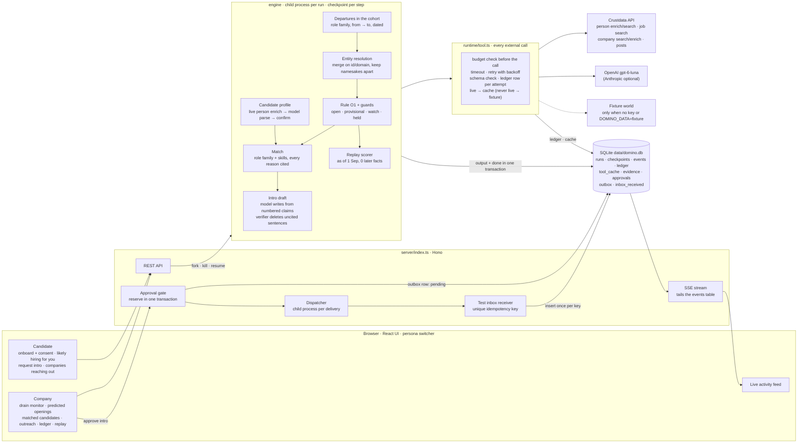

# DOMINO architecture

A search desk that predicts job openings before they are posted and makes the match with dated proof. GitHub renders the diagram below from [`architecture.mmd`](architecture.mmd); the full explanation is in the [README](../README.md#architecture-data-state-and-hosting).

**Flow.** A candidate onboards with their LinkedIn URL and consent (live Crustdata person enrich, model parse, confirmation). The engine reads dated departures across a cohort of AI companies, resolves entities, applies rule O1 with its false-drain guards (open, watch, held), and matches opted-in candidates to open predictions with cited fit reasons. An intro draft is written only from numbered, dated claims and checked by a verifier. A person approves it, and it is delivered once to a test inbox under an idempotency key. Every external call goes through one wrapper that enforces budgets, timeouts, retries and schema checks and writes a ledger row per attempt. State lives in SQLite, with a checkpoint per step, so a killed engine resumes without repeating calls.
