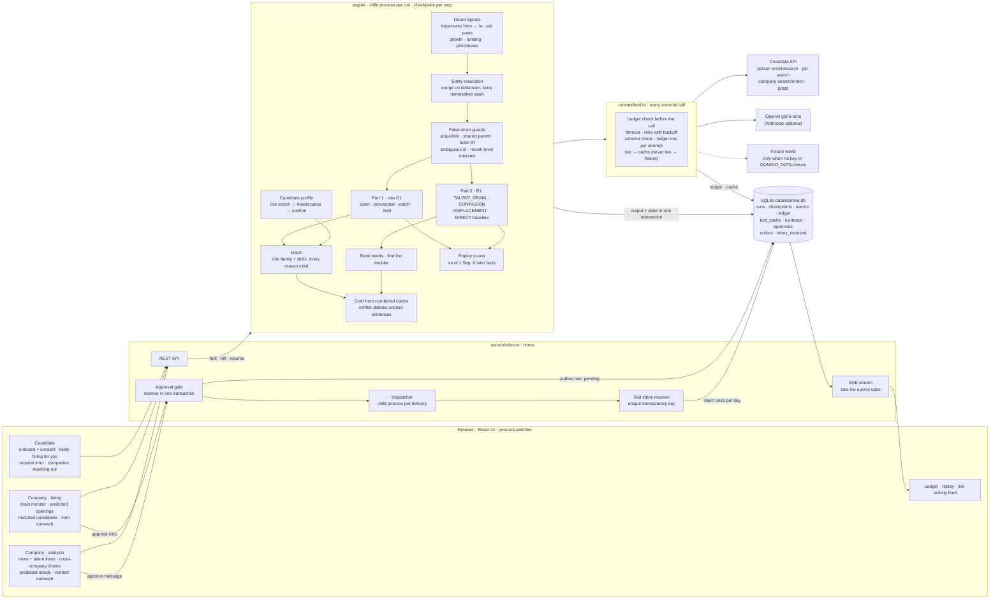

# DOMINO architecture

One product in two parts on one signal, dated moves between companies: (1) hiring, a search desk that predicts job openings before they are posted and makes the match with dated proof; (2) company analysis, with news, talent flows, cross-company chains, predicted needs and verified outreach. GitHub renders the diagram below from [`architecture.mmd`](architecture.mmd); the full explanation is in the [README](../README.md#architecture-data-state-and-hosting).

**Flow.** A candidate onboards with their LinkedIn URL and consent (live Crustdata person enrich, model parse, confirmation). The engine reads dated departures across a cohort of AI companies, resolves entities, applies shared false-drain guards, then rule O1 (open, provisional, watch, held) to match opted-in candidates to predicted openings with cited fit reasons, and the cross-company rules (R1 talent drain, contagion, displacement, with a first-order hiring baseline) to rank company needs and find the decider. Every intro or outreach draft is written only from numbered, dated claims and checked by a verifier. A person approves it, and it is delivered once to a test inbox under an idempotency key. Every external call goes through one wrapper that enforces budgets, timeouts, retries and schema checks and writes a ledger row per attempt. State lives in SQLite, with a checkpoint per step, so a killed engine resumes without repeating calls.
